# Guía de Estudio Fullstack: Tu Proyecto Gym

**Stack:** Backend en **Django + Django REST Framework (DRF)** · Frontend en **React Native + Expo + TypeScript**  
**Propósito:** Manual de referencia para repasar y dominar de principio a fin cómo funciona cada pieza de tu sistema, con definiciones claras y ejemplos reales tomados directamente de tus archivos.

---

## Índice

1. [Mapa General y Tabla de Equivalencias](#mapa-general-y-tabla-de-equivalencias)
2. [PARTE 1 — Backend (Django + Django REST Framework)](#parte-1--backend-django--django-rest-framework)
   - [1.1 Apps (Los módulos del proyecto)](#11-apps-los-módulos-del-proyecto)
   - [1.2 Models (`models.py`)](#12-models-modelspy)
   - [1.3 Serializers (`serializers.py`)](#13-serializers-serializerspy)
   - [1.4 Views vs ViewSets (`views.py`)](#14-views-vs-viewsets-viewspy)
   - [1.5 URLs y Routers (`urls.py`)](#15-urls-y-routers-urlspy)
   - [1.6 Flujo real punta a punta en el Backend](#16-flujo-real-punta-a-punta-en-el-backend)
3. [PARTE 2 — Frontend (React Native + Expo + TypeScript)](#parte-2--frontend-react-native--expo--typescript)
   - [2.1 Estructura de carpetas en `src/`](#21-estructura-de-carpetas-en-src)
   - [2.2 `api.ts` (El mensajero HTTP, NO toda la lógica)](#22-apits-el-mensajero-http-no-toda-la-lógica)
   - [2.3 `fetch`, `async` y `await`](#23-fetch-async-y-await)
   - [2.4 Contratos (`export interface` y `type`)](#24-contratos-export-interface-y-type)
   - [2.5 Componentes, Modales, `.ts` vs `.tsx`, Árbol Padre-Hijo y `Props`](#25-componentes-modales-ts-vs-tsx-árbol-padre-hijo-y-props)
   - [2.6 Hooks básicos de React (`useState`, `useEffect`, `useMemo`)](#26-hooks-básicos-de-react-usestate-useeffect-usememo)
   - [2.7 Custom Hooks y la variable `vm`](#27-custom-hooks-y-la-variable-vm)
   - [2.8 Acordeón de sintaxis JS/TS moderna en tu código](#28-acordeón-de-sintaxis-jsts-moderna-en-tu-código)
4. [PARTE 3 — Los 8 Temas Complementarios para Dominar el 100%](#parte-3--los-8-temas-complementarios-para-dominar-el-100)
   - [3.1 Autenticación con JWT, Tokens y Permisos](#31-autenticación-con-jwt-tokens-y-permisos)
   - [3.2 Context API y Providers (Estado Global)](#32-context-api-y-providers-estado-global)
   - [3.3 `useRef` y `useCallback` (Los otros 2 Hooks de React)](#33-useref-y-usecallback-los-otros-2-hooks-de-react)
   - [3.4 Manejo de errores y peticiones en paralelo (`try/catch/finally` y `Promise.all`)](#34-manejo-de-errores-y-peticiones-en-paralelo-trycatchfinally-y-promiseall)
   - [3.5 Patrones de JSX, listas `.map()`, estilos e idiomas (`i18n`)](#35-patrones-de-jsx-listas-map-estilos-e-idiomas-i18n)
   - [3.6 Subida de imágenes y configuración de red](#36-subida-de-imágenes-y-configuración-de-red)
   - [3.7 Migraciones y ORM avanzado de Django](#37-migraciones-y-orm-avanzado-de-django)
   - [3.8 Los otros 2 módulos de negocio (`routines` y `tracking`)](#38-los-otros-2-módulos-de-negocio-routines-y-tracking)

---

## Mapa General y Tabla de Equivalencias

Así viaja una petición desde que el usuario toca la pantalla hasta la base de datos y regresa:

```mermaid
flowchart LR
    UI["1. Pantalla .tsx (GymDashboard / Modales)"] -->|"Llama funcion de vm"| HOOK["2. Custom Hook (useGymDashboardData.ts)"]
    HOOK -->|"Pide datos / envia cambios"| API["3. Mensajero HTTP (src/services/api.ts)"]
    API -->|"fetch JSON + Token JWT"| URLS["4. URLs y Routers (urls.py)"]
    URLS -->|"Dirige ruta"| VIEWS["5. View o ViewSet (views.py)"]
    VIEWS -->|"Valida / Traduce JSON"| SER["6. Serializer (serializers.py)"]
    SER -->|"Lee o guarda"| MOD["7. Model (models.py) -> SQLite"]
    MOD -->|"Objeto Python -> JSON"| UI
```



| En Backend (Django) | En Frontend (React Native + TS) | Papel que cumple |
| :--- | :--- | :--- |
| **`apps/`** (`catalog`, `users`, `routines`, `tracking`) | **`src/components/dashboard/`** (`catalog/`, `routines/`, etc.) | Organización por módulos de negocio |
| **`urls.py` + `DefaultRouter`** | **`api.ts` (`fetch` + endpoints)** | Mapa de direcciones web entre app y servidor |
| **`views.py` / `ViewSet`** | **`useGymDashboardData.ts` (`vm`)** | Orquesta lógica, validaciones y acciones |
| **`serializers.py`** | **`export interface` en `api.ts`** | Contrato de entrada/salida del JSON |
| **`models.py` (SQLite)** | **`useState` + `Context` + `storage.ts`** | Dónde viven los datos (BD vs memoria/disco del teléfono) |
| *(Sin interfaz gráfica)* | **Componentes `.tsx` + `props`** | Lo que el usuario ve y toca |

---

## PARTE 1 — Backend (Django + Django REST Framework)

La forma más sencilla de entender el backend es imaginar un **restaurante** donde tu app del celular es el cliente que hace pedidos HTTP.

### 1.1 Apps (Los módulos del proyecto)

**Definición:** En lugar de meter todo en un solo archivo gigante, Django divide el sistema en departamentos independientes llamados **apps**, todos dentro de `apps/` y registrados en `INSTALLED_APPS` dentro de `Gym_Backend/settings.py`:

* **`apps/users/`**: Cuentas, registro, login con JWT, perfil de usuario y registro de peso corporal (`BodyWeightLog`).
* **`apps/catalog/`**: Máquinas (`Equipment`), grupos musculares (`MuscleGroup`), ejercicios (`Exercise`), material multimedia (`ExerciseMedia`) y favoritos.
* **`apps/routines/`**: Rutinas, días, ejercicios asignados y series objetivo.
* **`apps/tracking/`**: Sesiones de entrenamiento, series registradas y récords personales.

Además existe la carpeta **`Gym_Backend/`**, que es la configuración central (`settings.py` y el `urls.py` raíz que conecta a las 4 apps).

---

### 1.2 Models (`models.py`)

**Definición:** Un **Model** es una clase de Python que representa una **tabla en la base de datos**. Cada atributo es una columna y cada instancia de la clase es una fila. Aquí también se definen relaciones (`ForeignKey`, `ManyToManyField`) y comportamientos propios del dato (como generar el `slug` o comprimir fotos en `save()`).

**Detalle importante de tus IDs:**
* `Equipment` usa el `id` autoincremental clásico de Django (`number`: `1, 2, 3...`).
* `Exercise` declara `id = models.UUIDField(primary_key=True, default=uuid.uuid4, editable=False)`, por eso en el frontend su `id` llega como `string` (`"87b4eccd-..."`).

**Ejemplo real** (`apps/catalog/models.py`):

```python
class Equipment(models.Model):
    name = models.CharField(max_length=120, unique=True)
    equipment_type = models.CharField(max_length=30, choices=EQUIPMENT_TYPES, default='plate_loaded')
    brand = models.CharField(max_length=100, blank=True)
    image = models.ImageField(upload_to='equipment/', null=True, blank=True, validators=[validate_image])
    setup_guide = models.TextField(blank=True)

class Exercise(models.Model):
    id = models.UUIDField(primary_key=True, default=uuid.uuid4, editable=False)
    name = models.CharField(max_length=150, unique=True)
    equipment = models.ForeignKey(Equipment, on_delete=models.SET_NULL, null=True, blank=True, related_name='exercises')
    muscles = models.ManyToManyField(MuscleGroup, through='ExerciseMuscle', related_name='exercises')
    image = models.ImageField(upload_to='exercises/', null=True, blank=True, validators=[validate_image])
    instructions = models.TextField()

class UserFavoriteExercise(models.Model):
    user = models.ForeignKey(settings.AUTH_USER_MODEL, on_delete=models.CASCADE, related_name='favorite_exercises_set')
    exercise = models.ForeignKey(Exercise, on_delete=models.CASCADE, related_name='favorited_by')
    created_at = models.DateTimeField(auto_now_add=True)

    class Meta:
        unique_together = ('user', 'exercise')  # Un usuario no puede repetir el mismo favorito
```

---

### 1.3 Serializers (`serializers.py`)

**Definición:** El **Serializer** es el **traductor y la aduana** entre Python/SQL y JSON:
1. **Salida (BD → JSON):** Convierte objetos de Django a texto JSON para enviarlos al celular.
2. **Entrada (JSON → BD):** Valida que los datos que manda el frontend sean correctos antes de llamar a `.create()` o `.update()`.

**Ejemplo real** (`apps/catalog/serializers.py`):
Para `Exercise` tienes **dos** serializers según cuánta información necesites:
* `ExerciseListSerializer`: versión ligera para el catálogo (`id`, `name`, `equipment_name`, `primary_muscle`, `is_favorite`, `image`).
* `ExerciseDetailSerializer`: versión completa cuando abres o editas un ejercicio (anida el objeto `EquipmentSerializer`, la lista `muscles`, `media`, y acepta campos de escritura como `equipment_id`, `muscle_id`, `video_url` y `image` mediante `FlexibleImageField`).

```python
class ExerciseDetailSerializer(serializers.ModelSerializer):
    equipment = EquipmentSerializer(read_only=True)  # Solo lectura al responder JSON
    equipment_id = serializers.PrimaryKeyRelatedField(
        queryset=Equipment.objects.all(), source='equipment', write_only=True, required=False, allow_null=True
    )  # Solo escritura al crear/editar (recibe el ID numérico)
    image = FlexibleImageField(required=False, allow_null=True, validators=[validate_image])
    is_favorite = serializers.BooleanField(read_only=True, default=False)
```

> **Ejemplo de "aduana":** Cuando el frontend enviaba por error la URL `"http://.../foto.webp"` dentro de `image`, fue `FlexibleImageField` quien rechazó la petición con HTTP `400` porque esperaba un archivo real o Base64 válido.

---

### 1.4 Views vs ViewSets (`views.py`)

**Definición:** Son los **"meseros / cerebros"** que reciben una petición HTTP (`GET`, `POST`, `PATCH`, `DELETE`), verifican permisos, consultan los Models, pasan los datos por el Serializer y devuelven un `Response`.

#### A) Views (para rutas puntuales y específicas)
Se usan cuando un endpoint hace **1 o 2 acciones muy concretas**. Ejemplo en `apps/users/views.py`:

```python
class RegisterView(generics.CreateAPIView):         # Solo POST /auth/register/
    queryset = User.objects.all()
    serializer_class = UserRegistrationSerializer
    permission_classes = [permissions.AllowAny]

class UserProfileView(generics.RetrieveUpdateAPIView):  # GET y PATCH /auth/profile/
    serializer_class = UserProfileSerializer
    permission_classes = [permissions.IsAuthenticated]

    def get_object(self):
        return self.request.user  # Solo devuelve/edita al usuario dueño del token
```

#### B) ViewSets (paquete CRUD completo en una sola clase)
Cuando un recurso necesita crear, listar, ver detalle, editar y borrar, usas `viewsets.ModelViewSet`. Ejemplo en `apps/catalog/views.py`:

```python
class ExerciseViewSet(viewsets.ModelViewSet):
    queryset = Exercise.objects.prefetch_related('exercise_muscles__muscle', 'media').select_related('equipment').all()
    permission_classes = [IsAdminOrReadOnly]

    def get_serializer_class(self):
        if self.action == 'list':
            return ExerciseListSerializer     # Ligero para la lista
        return ExerciseDetailSerializer       # Completo para detalle, POST y PATCH

    # Botón/endpoint extra que NO es CRUD estándar: POST /exercises/<id>/favorite/
    @action(detail=True, methods=['post'], permission_classes=[permissions.IsAuthenticated], url_path='favorite')
    def toggle_favorite(self, request, pk=None):
        exercise = self.get_object()
        fav, created = UserFavoriteExercise.objects.get_or_create(user=request.user, exercise=exercise)
        if not created:
            fav.delete()
            return Response({'is_favorite': False, 'exercise_id': str(exercise.id)})
        return Response({'is_favorite': True, 'exercise_id': str(exercise.id)}, status=status.HTTP_201_CREATED)

    # Endpoint extra sobre toda la colección: GET /exercises/favorites/
    @action(detail=False, methods=['get'], permission_classes=[permissions.IsAuthenticated], url_path='favorites')
    def list_favorites(self, request):
        queryset = self.get_queryset().filter(favorited_by__user=request.user)
        serializer = self.get_serializer(queryset, many=True)
        return Response(serializer.data)
```

---

### 1.5 URLs y Routers (`urls.py`)

**Definición:** Es el **recepcionista** que conecta cada dirección web con su View o ViewSet. Tu proyecto usa **2 niveles**:

1. **Nivel 1 — Mapa raíz (`Gym_Backend/urls.py`):** Reparte el tráfico por prefijo hacia cada app:
   ```python
   urlpatterns = [
       path('admin/', admin.site.urls),
       path('api/v1/auth/', include('apps.users.urls')),
       path('api/v1/catalog/', include('apps.catalog.urls')),
       path('api/v1/routines/', include('apps.routines.urls')),
       path('api/v1/tracking/', include('apps.tracking.urls')),
   ]
   ```

2. **Nivel 2 — Rutas internas de cada app:**
   * **Manuales con `path()` (para Views):** En `apps/users/urls.py` escribes cada ruta una por una:
     ```python
     path('register/', RegisterView.as_view(), name='auth_register'),
     path('login/', CustomTokenObtainPairView.as_view(), name='auth_login'),
     path('profile/', UserProfileView.as_view(), name='user_profile'),
     ```
   * **Automáticas con `DefaultRouter()` (para ViewSets):** En `apps/catalog/urls.py`, una sola línea `router.register(...)` crea todas las rutas CRUD (`GET /`, `POST /`, `GET /<id>/`, `PATCH /<id>/`, `DELETE /<id>/`) y las rutas `@action` (`/favorite/` y `/favorites/`):
     ```python
     router = DefaultRouter()
     router.register(r'equipment', EquipmentViewSet, basename='equipment')
     router.register(r'muscles', MuscleGroupViewSet, basename='muscles')
     router.register(r'exercises', ExerciseViewSet, basename='exercises')
     ```
   * **Híbrido (`apps/tracking/urls.py`):** Combina `router` (para `sessions`, `exercises`, `sets`) con rutas manuales `path('progression/<uuid:exercise_id>/', ...)` y `path('progress/weight-1rm/', ...)`.

---

### 1.6 Flujo real punta a punta en el Backend

Cuando editas la máquina de un ejercicio y presionas Guardar:

1. Llega `PATCH http://.../api/v1/catalog/exercises/<uuid>/` con `{ "name": "...", "equipment_id": 6 }`.
2. `Gym_Backend/urls.py` ve `/api/v1/catalog/` y lo pasa a `apps/catalog/urls.py`.
3. `DefaultRouter` reconoce `exercises/<uuid>/` + método `PATCH` y lo manda al método `partial_update` de **`ExerciseViewSet`**.
4. `ExerciseViewSet` verifica `IsAdminOrReadOnly` (`user.is_staff == True`), busca el ejercicio en la BD con el **Model** `Exercise` y selecciona `ExerciseDetailSerializer`.
5. `ExerciseDetailSerializer` valida que exista la máquina `6`, guarda el cambio en SQLite (`update()`) y convierte el resultado actualizado a JSON.
6. Django responde **`200 OK`** con el JSON actualizado.

---

## PARTE 2 — Frontend (React Native + Expo + TypeScript)

### 2.1 Estructura de carpetas en `src/`

| Carpeta | Responsabilidad | Archivos clave |
| :--- | :--- | :--- |
| **`src/app/`** | Punto de entrada de Expo. Envuelve la app con Providers y decide si mostrar Login o Dashboard. | `_layout.tsx`, `index.tsx` |
| **`src/context/`** | Memoria global compartida para toda la app (sesión, colores, idioma). | `AuthContext.tsx`, `ThemeContext.tsx`, `LanguageContext.tsx` |
| **`src/services/`** | Comunicación con la API REST y almacenamiento persistente del teléfono. | `api.ts`, `storage.ts`, `preferences.ts` |
| **`src/hooks/`** | Custom Hooks que encapsulan estados (`useState`), efectos (`useEffect`) y acciones de negocio. | `useGymDashboardData.ts`, `use-theme.ts` |
| **`src/components/`** | Todo lo visual (UI): pantallas, tarjetas, modales y formularios. | `GymDashboard.tsx`, `DashboardHeader.tsx`, `AddExerciseModal.tsx`, `EditExerciseForm.tsx` |
| **`src/constants/` y `src/i18n/`** | Tokens visuales (colores/radios/espaciado) y diccionarios de textos (`es.ts` / `en.ts`). | `theme.ts`, `es.ts`, `en.ts` |

---

### 2.2 `api.ts` (El mensajero HTTP, NO toda la lógica)

**Regla clave:** `src/services/api.ts` **NO** maneja toda la lógica del frontend. Es únicamente el **mensajero HTTP**. Su trabajo es:
* Calcular la dirección del servidor (`API_BASE_URL`).
* Leer el token JWT del teléfono (`storage.getAccessToken()`) y pegarlo en el header `Authorization: Bearer <token>`.
* Serializar los datos a enviar (JSON o `FormData` multiparte si lleva foto).
* Si Django responde error, lanzar un `ApiError(status, message, data)`.

Quien realmente controla el estado de la pantalla, los modales, los Toasts y las recargas es el **Custom Hook** `useGymDashboardData.ts`.

---

### 2.3 `fetch`, `async` y `await`

* **`fetch`**: Función nativa que envía la petición HTTP por red a Django (como hacer un Postman desde código).
* **`async`**: Marca una función como asíncrona (es decir, que ejecutará operaciones que tardan, como ir a la red o leer el disco).
* **`await`**: Se usa **dentro** de funciones `async`. Le dice a JavaScript: *"Espérate en esta línea hasta que el servidor responda, guarda el resultado y continúa, pero sin congelar los botones ni animaciones de la app"*.

**Ejemplo real** (`src/services/api.ts`):

```ts
async function request<T>(endpoint: string, options: RequestInit = {}): Promise<T> {
  const token = await storage.getAccessToken(); // Espera leer token del celular
  const headers: Record<string, string> = {
    ...(isMultipart ? {} : { "Content-Type": "application/json" }),
    Accept: "application/json",
    ...(options.headers as Record<string, string>),
  };
  if (token) headers["Authorization"] = `Bearer ${token}`;

  const url = `${API_BASE_URL}${endpoint}`;
  const response = await fetch(url, { ...options, headers }); // Dispara peticion HTTP y espera respuesta
  const data = await response.json().catch(() => ({}));     // Convierte el cuerpo JSON en objeto JS

  if (!response.ok) {
    throw new ApiError(response.status, data.detail || "Error en la petición", data);
  }
  return data as T;
}
```

---

### 2.4 Contratos (`export interface` y `type`)

Un **contrato** define qué propiedades exactas y de qué tipo (`string`, `number`, `boolean`, función) debe tener un objeto. TypeScript los revisa mientras escribes código para atrapar errores antes de correr la app.  
*(Sintaxis: se escribe **`export interface Nombre { ... }`**, sin `const`.)*

Tienes **dos tipos de contratos** en tu proyecto:

1. **Contratos de Datos (espejo de los Serializers de Django)** en `src/services/api.ts`:
   ```ts
   export interface Equipment {
     id: number;
     name: string;
     equipment_type: string;
     brand: string;
     image?: string | null; // "?" indica que la propiedad es opcional
   }
   ```
   Si escribes `eq.nombre` en vez de `eq.name`, TypeScript te marca error al instante.

2. **Contratos de Props (reglas entre Padre e Hijo)** al inicio de cada componente `.tsx`:
   ```ts
   export interface AddExerciseModalProps {
     colors: DashboardColors;
     visible: boolean;
     equipmentList: Equipment[];
     onSubmit: () => void;
     onClose: () => void;
   }
   ```
   Al amarrar el componente con `export const AddExerciseModal: React.FC<AddExerciseModalProps> = ...`, obligas al padre a pasar exactamente esos `props`.

---

### 2.5 Componentes, Modales, `.ts` vs `.tsx`, Árbol Padre-Hijo y `Props`

* **`.ts` vs `.tsx`:**
  * **`.ts`**: TypeScript puro, **sin** etiquetas visuales (`useGymDashboardData.ts`, `api.ts`, `muscleValidation.ts`, `es.ts`). Un archivo `.ts` **no** es automáticamente un hook; solo lo es si exporta una función que empieza con `use...`.
  * **`.tsx`**: TypeScript **+** JSX (etiquetas visuales de React Native como `<View>`, `<Text>`, `<Modal>`).
* **¿Qué es un Modal?** Es una ventana flotante superpuesta (`<Modal visible={...}>`) para crear, editar o ver detalles sin salir de la pantalla actual (`AddExerciseModal`, `EditItemModal`, `ExerciseDetailModal`).
* **Árbol Padre → Hijo en tu app:** Quien escribe `<ComponenteB />` dentro de su `return` es el **padre**.
  ```text
  RootLayout (_layout.tsx)
   └── HomeScreen (index.tsx)
        └── GymDashboard (Padre del dashboard)
             ├── DashboardHeader (Hijo)
             ├── CatalogSection (Hijo)
             ├── AddExerciseModal (Hijo)
             └── EditItemModal (Hijo)
                  └── EditExerciseForm (Nieto: hijo de EditItemModal)
  ```
* **Cómo reparte `Props` el Padre:** En `GymDashboard.tsx` solo importas al componente hijo (no hace falta importar su `interface`) y le pasas las propiedades solicitadas. Los datos **bajan** del padre al hijo, y las acciones **suben** cuando el hijo ejecuta la función que le pasaron:
  ```tsx
  <DashboardHeader
    username={user?.username || t("header.defaultAthlete")}
    isAdmin={Boolean(user?.is_staff)}
    routinesCount={vm.routines.length}
    exercisesCount={vm.exercises.length}
    colors={colors}
    trainedCount={trainedCount}
    onRefresh={handleManualRefresh}
    refreshing={vm.refreshing}
  />
  ```

#### Anatomía estándar de cualquier componente `.tsx` (4 zonas):
1. **Arriba del componente (fuera):** `import`, `interface ...Props`, constantes fijas (`WEEK_DAYS`) y funciones puras auxiliares (`computeElapsedSeconds`). Se ejecuta una sola vez al cargar el módulo.
2. **Dentro del componente, antes del `return` ("la cocina"):** conexión a contexts y hooks (`const vm = useGymDashboardData()`), `useState`/`useRef` locales, `useEffect`, funciones de botones (`handle...`) y variables derivadas (`isAdmin`, `selectedRoutineDetail`).
3. **`return (...)` (lo visual):** etiquetas JSX y reparto de `props` a componentes hijos.
4. **Abajo del archivo:** `const styles = StyleSheet.create({ ... })`.

---

### 2.6 Hooks básicos de React (`useState`, `useEffect`, `useMemo`)

#### `useState` — Memoria reactiva que redibuja la pantalla
Sintaxis: `const [x, setX] = useState(valorInicial);`
* **`x`**: El valor actual (solo lectura). Puede ser booleano, texto, número, objeto o array.
* **`setX`**: Función que cambia `x` **y le avisa a React que vuelva a dibujar** la pantalla (`set` = establecer/asignar).

**¿Por qué `exercises` es un `useState`?**  
Al abrir la app (`t = 0`), `exercises` arranca vacío (`[]`). Cuando llegan los datos de Django y llamas `setExercises(exList)`, React se entera del cambio y pinta las tarjetas. Si fuera un `let` normal, la pantalla nunca se enteraría ni se refrescaría.

> **Regla de oro:** Nunca modifiques un estado asignando directo (`exName = "Otro"`). Usa siempre su función `setExName("Otro")`.

#### `useEffect` — Disparador automático de acciones
Ejecuta código cuando nace el componente o cuando cambia alguna variable de su lista de dependencias:
```ts
useEffect(() => {
  loadInitialData(); // Acción a ejecutar
}, []);              // [] vacío = "ejecútalo solo 1 vez al abrir esta pantalla"
```
Otro ejemplo: en `EditItemModal.tsx`, `useEffect` escucha `[visible, exerciseData, ...]` para rellenar los inputs del formulario cada vez que abres la ventana de edición.

#### `useMemo` — Caché de cálculos o filtros
Calcula un valor y **lo recuerda en memoria** para no repetir el cálculo en cada redibujado; solo lo recalcula si cambia algo en su array de dependencias `[...]`.

**Ejemplo real** (`EditExerciseForm.tsx`):
```ts
const filteredEquipmentList = useMemo(() => {
  if (!selectedMuscleObj) return equipmentList;
  return equipmentList.filter((eq) =>
    isEquipmentCompatibleWithMuscle(
      eq.name,
      `${selectedMuscleObj.name} ${selectedMuscleObj.body_part || ""}`,
    ),
  );
}, [equipmentList, selectedMuscleObj]);
```
Si escribes 30 letras en el nombre del ejercicio, NO vuelve a filtrar todas las máquinas 30 veces; solo refiltra si cambia el músculo elegido o `equipmentList`.

| Hook | Qué hace en una frase | ¿Devuelve un valor para pintar? | Ejemplo en tu app |
| :--- | :--- | :--- | :--- |
| **`useState`** | Guarda un dato y refresca la UI cuando cambia | Sí: `[dato, setDato]` | `exercises`, `showAddExerciseModal`, `exName` |
| **`useEffect`** | Ejecuta una acción secundaria cuando algo cambia | No (solo dispara efectos) | Pedir catálogo al iniciar, cronómetro de sesión |
| **`useMemo`** | Guarda el resultado de un cálculo/filtro en caché | Sí: el valor calculado | `filteredEquipmentList`, `matchedEquipment` |

---

### 2.7 Custom Hooks y la variable `vm`

* **Relación entre los 3 nombres:**
  * `src/hooks/useGymDashboardData.ts` → es el **archivo**.
  * `export function useGymDashboardData()` → es el **Custom Hook** (función que combina varios `useState`, `useEffect` y acciones).
  * `const vm = useGymDashboardData()` → **`vm`** (**V**iew**M**odel) es solo el nombre de la variable donde `GymDashboard.tsx` guarda el objeto que el hook retornó.
* **¿Por qué solo el padre llama a `useGymDashboardData()`?** Si cada componente hijo llamara al hook, cada uno crearía su propia copia aislada de los datos y haría peticiones repetidas a Django. Por eso el padre lo ejecuta una sola vez y reparte lo necesario por `props` (`vm.exercises`, `vm.routines`, etc.).
* **¿Viven TODOS los datos en `useGymDashboardData`?** Casi todos los del dashboard (`exercises`, `routines`, `equipmentList`, `muscleList`, `marcaHistory`, `adminUsers`, modales de creación/edición, `loading`, `toast`). Viven aparte a propósito:
  * Usuario, tokens y perfil → `AuthContext.tsx` (existen desde antes de entrar al dashboard).
  * Tema e idioma → `ThemeContext.tsx` y `LanguageContext.tsx`.
  * Cronómetro de sesión activa y asistencia semanal (`trainedDayFlags`) → estados locales dentro de `GymDashboard.tsx`.

**Ejemplo corto (`src/hooks/use-theme.ts`):**
```ts
import { useAppTheme } from '@/context/ThemeContext';

export function useTheme() {
  const { colors } = useAppTheme();
  return colors;
}
```

**Estructura de 4 bloques del Custom Hook completo (`useGymDashboardData.ts`):**
1. **Bloque 1 — Estados (`useState`):** listas, formularios, interruptores booleanos de modales (`showAddExerciseModal`).
2. **Bloque 2 — Efectos (`useEffect`):** carga inicial (`loadInitialData()`).
3. **Bloque 3 — Acciones (`handle...`):** hablar con `api.ts` y actualizar el estado con `set...`.
4. **Bloque 4 — `return { ... }`:** la caja etiquetada que `GymDashboard.tsx` recibe como `vm`.

---

### 2.8 Acordeón de sintaxis JS/TS moderna en tu código

| Sintaxis | Nombre | Qué hace en tu código |
| :--- | :--- | :--- |
| `(a, b) => { ... }` | Arrow function | Declara una función corta sin usar la palabra `function` |
| `cond ? si : no` | Operador ternario | `if / else` en una sola línea |
| `obj?.prop` / `arr?.[0]` | Optional chaining | Lee la propiedad o posición `0` solo si existe; si es `null`/`undefined`, devuelve `undefined` sin crashear |
| `valor \|\| respaldo` | Fallback | Si `valor` es vacío/`null`/`0`/`false`, usa `respaldo` |
| `arr.find((r) => ...)` | Buscar elemento | Devuelve el **primer objeto completo** del array que cumpla la condición |
| `arr.forEach((x) => ...)` | Recorrer array | Ejecuta un bloque por cada elemento `x` de la lista |
| `list.push(item)` | Insertar | Agrega `item` al final del array `list` |

**Ejemplo 1 — Ternario + `.find()`** (`GymDashboard.tsx`):
```ts
const routineObj = routineId
  ? vm.routines.find((r) => r.id === routineId)
  : undefined;
```
Si `routineId` existe, busca dentro de `vm.routines` la rutina cuyo `r.id` coincida y devuelve ese objeto completo; si no, asigna `undefined`.

**Ejemplo 2 — Desglose de `getExercisesOfRoutine`** (`useGymDashboardData.ts`):
Aplana la estructura anidada `Routine → days → exercises → target_sets` en una sola lista `RoutineExerciseItem[]`:
```ts
const getExercisesOfRoutine = (routine?: Routine): RoutineExerciseItem[] => {
  if (!routine || !routine.days) return [];             // Barrera si no hay rutina o días
  const list: RoutineExerciseItem[] = [];               // Array acumulador
  routine.days.forEach((d) => {                         // Bucle 1: cada día "d"
    d.exercises?.forEach((e) => {                       // Bucle 2: cada ejercicio "e" del día
      const sc = e.target_sets?.length || 4;            // Cantidad de series (4 por defecto)
      const firstSet = e.target_sets?.[0];              // Primera serie de forma segura
      list.push({
        id: e.exercise,
        name: e.exercise_detail?.name || t("common.exerciseFallback"),
        routineExerciseId: e.id,
        equipmentName: e.exercise_detail?.equipment_name,
        setsCount: sc,
        minReps: firstSet?.min_reps || 8,
        maxReps: firstSet?.max_reps || 12,
      });
    });
  });
  return list;                                          // Entrega la lista aplanada
};
```

---

## PARTE 3 — Los 8 Temas Complementarios para Dominar el 100%

### 3.1 Autenticación con JWT, Tokens y Permisos

Cuando haces login, Django verifica tu usuario y te entrega **dos tokens JWT** configurados en `Gym_Backend/settings.py`:
```python
SIMPLE_JWT = {
    'ACCESS_TOKEN_LIFETIME': timedelta(days=7),   # Pase de entrada válido por 7 días
    'REFRESH_TOKEN_LIFETIME': timedelta(days=30), # Llave para renovar el pase por 30 días
    'ROTATE_REFRESH_TOKENS': True,
    'AUTH_HEADER_TYPES': ('Bearer',),
}
```

1. **Persistencia en el teléfono (`src/services/storage.ts`):**
   Al iniciar sesión o registrarte, `AuthContext.tsx` guarda `access`, `refresh` y los datos del usuario en disco mediante `AsyncStorage` (`@gym_access_token`, `@gym_refresh_token`, `@gym_user_data`). Al cerrar y volver a abrir la app, `loadSavedSession()` lee ese token guardado y pide `api.getProfile()` para revalidar la sesión sin mandarte al Login.
2. **Permisos en Backend (`apps/catalog/permissions.py`):**
   ```python
   class IsAdminOrReadOnly(BasePermission):
       def has_permission(self, request, view):
           if request.method in SAFE_METHODS:  # GET, HEAD, OPTIONS -> permitido para todos
               return True
           return bool(request.user and request.user.is_authenticated and request.user.is_staff)
   ```
   Cualquier usuario autenticado puede **leer** máquinas y ejercicios, pero solo un administrador (`is_staff=True`) puede crear, editar o borrar (`POST`, `PATCH`, `DELETE`).
3. **Permisos en Frontend:** En `GymDashboard.tsx` calculas `const isAdmin = Boolean(user?.is_staff)` para ocultar botones de administración a usuarios normales, y en `useGymDashboardData.ts` llamas a `requireAdmin()` antes de disparar acciones administrativas.

---

### 3.2 Context API y Providers (Estado Global)

**El problema que resuelve:** Si tuvieras que pasar `user`, `colors` y la función traductora `t()` mediante `props` por 5 niveles de componentes (*prop drilling*), el código sería interminable.

**Cómo funciona:**
1. **`createContext(...)`**: Crea un "canal de radio" global (`AuthContext`, `ThemeContext`, `LanguageContext`).
2. **`<Provider value={...}>{children}</Provider>`**: La "antena" que transmite los datos a todo lo que envuelva. En `src/app/_layout.tsx` están anidados así:
   ```tsx
   <AppThemeProvider>
     <LanguageProvider>
       <RootLayoutContent /> {/* Adentro envuelve a HomeScreen con <AuthProvider> */}
     </LanguageProvider>
   </AppThemeProvider>
   ```
3. **`useContext(...)`**: El "radio receptor". Cada contexto expone un hook corto (`useAuth()`, `useAppTheme()`, `useLanguage()`) para sintonizar esos datos desde cualquier componente sin pasarlos por `props`.

---

### 3.3 `useRef` y `useCallback` (Los otros 2 Hooks de React)

* **`useRef` — Caja persistente que NO refresca la pantalla:**
  A diferencia de `useState`, cuando modificas `miRef.current = nuevoValor`, React **NO** redibuja el componente. Sirve para guardar referencias técnicas internas:
  * `timerRef` en `GymDashboard.tsx`: guarda el ID del `setInterval(..., 1000)` del cronómetro de entrenamiento para poder detenerlo con `clearInterval(timerRef.current)`.
  * `refreshInFlightRef` en `useGymDashboardData.ts`: bandera `true/false` que evita lanzar dos recargas globales al mismo tiempo si cambias rápido de pestaña.
* **`useCallback` — `useMemo` pero para funciones:**
  Recuerda exactamente la misma referencia en memoria de una función entre redibujados para evitar que un `useEffect` que depende de esa función se dispare en bucle infinito.
  * Ejemplo en `GymDashboard.tsx`: `const loadWeeklyAndHistory = useCallback(async () => { ... }, []);` usada después dentro de `useEffect(..., [vm.activeTab, routinesSubTab, loadWeeklyAndHistory])`.

---

### 3.4 Manejo de errores y peticiones en paralelo (`try/catch/finally` y `Promise.all`)

#### A) `try / catch / finally`
Estructura de seguridad para código que puede fallar (como peticiones HTTP):
```ts
try {
  setLoading(true);                              // 1. Prende spinner
  await api.updateExercise(id, payload);         // 2. Intenta la petición
  showToast("success", ...);                     // 3. Si tuvo éxito, avisa
} catch (e: any) {
  showToast("error", t("toasts.updateExerciseError"), e.message); // 4. Si falló, atrapa el error sin crashear
} finally {
  setLoading(false);                             // 5. SIEMPRE se ejecuta (falle o no) para apagar el spinner
}
```

#### B) `Promise.all([...])`
Si esperaras una petición detrás de otra en fila (`await A`, luego `await B`, luego `await C`, luego `await D`), el usuario esperaría la **suma** de los 4 tiempos. Con `Promise.all` en `loadInitialData()` y `refreshAllData()` (`useGymDashboardData.ts`) lanzas las 4 peticiones **al mismo tiempo en paralelo**:
```ts
const [exList, rList, eqList, muList] = await Promise.all([
  api.getExercises(),
  api.getRoutines(),
  api.getEquipment().catch(() => null),
  api.getMuscles().catch(() => null),
]);
```

---

### 3.5 Patrones de JSX, listas `.map()`, estilos e idiomas (`i18n`)

1. **Renderizado condicional en JSX:**
   * **`&&` (mostrar u ocultar):** `{isAdmin && <AddExerciseModal ... />}` — solo monta ese modal en el árbol si `isAdmin` es `true`.
   * **Ternario `? :` (elegir entre A o B):** `{equipmentImageUrl ? <Image source={{ uri: equipmentImageUrl }} /> : <GymIcon name="cog" />}` en `ExerciseDetailModal.tsx`.
2. **Listas con `.map()` y la importancia de `key`:**
   En React, cuando transformas un array en componentes visuales con `.map()`, cada elemento hijo directo debe llevar una `key` única y estable para que React sepa cuál elemento cambió sin confundirlos ni lanzar advertencias en consola:
   ```tsx
   {primaryMuscles.map((m, idx) => (
     <View key={m.id ?? m.muscle ?? `${m.muscle_name}-${idx}`} style={...}>
       <Text>{m.muscle_name}</Text>
     </View>
   ))}
   ```
3. **Estilos con `StyleSheet.create` y arreglos dinámicos:**
   Los estilos fijos (tamaños, bordes, fuente) van abajo del archivo en `StyleSheet.create({...})`, y dentro del JSX se combinan en un array `[...]` con los colores dinámicos del tema (`dark` / `light`):
   ```tsx
   <View style={[styles.infoBox, { backgroundColor: colors.backgroundElevated, borderColor: colors.borderSubtle }]} />
   ```
4. **Internacionalización (`i18n`):**
   `const { t } = useLanguage()` busca la clave en `src/i18n/es.ts` o `src/i18n/en.ts` según el idioma activo. Por ejemplo, `t("tabs.catalog")` devuelve `"Catálogo"` en español o `"Catalog"` en inglés.

---

### 3.6 Subida de imágenes y configuración de red

#### A) Ciclo de vida completo de una foto
1. **Selección y compresión en Frontend (`pickAndCompressImage` en `api.ts`):**
   Abre cámara o galería con `ImagePicker`, redimensiona el lado largo a máximo `1080px` con `ImageManipulator` (`compress: 0.7`, WebP en web / JPEG en móvil) y genera un `PickedImageAsset` con `uri`, `file` y `base64`.
2. **Empaquetado (`serializePayloadWithImage` en `api.ts`):**
   * Si hay un `PickedImageAsset` nuevo con `base64`, arma un JSON con Data URI (`data:image/jpeg;base64,...`). Si solo tiene `uri`/`file`, arma un `FormData` multiparte.
   * Si **no** seleccionaste imagen nueva (o viene una URL string existente), **omite** el campo `image` en el `PATCH` para no provocar error de validación en Django.
3. **Validación y optimización en Backend (`apps/catalog/models.py` y `serializers.py`):**
   * `FlexibleImageField` decodifica tanto archivos multiparte como Base64.
   * `validate_image` exige máximo `5 MB` y extensión `.jpg`, `.jpeg`, `.png` o `.webp`.
   * En `save()`, `optimize_image()` usa **Pillow** (`PIL`) para corregir rotación EXIF, limitar a `1080x1080` y convertirla a `.webp` optimizado; `delete_old_file_on_update` y el signal `post_delete` limpian archivos viejos del disco.
4. **Lectura en Frontend:** Django sirve las fotos desde `MEDIA_URL = '/media/'` (mapeado en `Gym_Backend/urls.py` cuando `DEBUG = True`) y `resolveMediaUrl()` en `api.ts` convierte rutas relativas `/media/...` en URLs absolutas con la IP del servidor.

#### B) Configuración de red (PC ↔ Celular)
* En **Frontend (`.env` y `api.ts`):** `EXPO_PUBLIC_DEV_PC_IP=192.168.0.16` (o la IP detectada automáticamente de `Constants.expoConfig.hostUri`) construye `API_BASE_URL` para Android/iOS (`http://<IP>:8000/api/v1`), mientras en web apunta a `http://127.0.0.1:8000/api/v1`.
* En **Backend (`Gym_Backend/settings.py`):**
  * `ALLOWED_HOSTS = ['*']` permite recibir conexiones desde la IP LAN de tu celular en desarrollo.
  * `CORS_ALLOW_ALL_ORIGINS = True` permite peticiones desde Expo Web sin bloqueo del navegador.
  * `DATA_UPLOAD_MAX_MEMORY_SIZE` y `FILE_UPLOAD_MAX_MEMORY_SIZE` están fijados en `10 MB` para soportar payloads Base64/imágenes.

---

### 3.7 Migraciones y ORM avanzado de Django

#### A) Migraciones (`makemigrations` y `migrate`)
Cuando agregas o modificas una clase en `models.py`, la base de datos SQLite **no** cambia sola.
1. `python manage.py makemigrations`: compara tus `models.py` con el historial y crea un archivo Python con los cambios (ejemplo real: `apps/catalog/migrations/0003_userfavoriteexercise.py`).
2. `python manage.py migrate`: traduce esa migración a comandos SQL (`CREATE TABLE`, `ALTER TABLE`) y los aplica en `db.sqlite3`.

#### B) Consultas optimizadas en `apps/catalog/views.py`
Tu backend evita hacer cientos de consultas repetidas a la base de datos (problema *N+1*) con estas herramientas del ORM:
* **`select_related('equipment')`**: Hace un `SQL JOIN` en la misma consulta para traer la máquina (`ForeignKey`) junto con cada ejercicio.
* **`prefetch_related('exercise_muscles__muscle', 'media')`**: Trae relaciones múltiples (`ManyToMany` / inversas) en 1 consulta adicional en bloque en vez de 1 consulta por cada ejercicio.
* **`annotate(is_favorite=Exists(...))` + `OuterRef('pk')`**: Calcula en una sola subconsulta SQL si cada ejercicio está en `UserFavoriteExercise` para ese usuario, inyectando el booleano `is_favorite` directo en cada fila.
* **`with transaction.atomic():`** (en `perform_destroy`): Garantiza que borrar las referencias del ejercicio en rutinas/registros y borrar el ejercicio ocurran como un "todo o nada"; si algo falla a mitad de camino, la base de datos revierte todo para no quedar corrupta.

---

### 3.8 Los otros 2 módulos de negocio (`routines` y `tracking`)

#### A) Módulo `routines` (`apps/routines/models.py`)
Estructura tus planes de entrenamiento en una jerarquía de **4 niveles**:
```text
Routine (id UUID, user, title, is_template, is_active)
 └── RoutineDay (id UUID, routine, name, order)
      └── RoutineExercise (id UUID, routine_day, exercise, order, rest_seconds, tempo, notes)
           └── RoutineSet (set_number, set_type, min_reps, max_reps, target_rpe, target_rir, target_weight)
```
Por eso en el frontend existe `getExercisesOfRoutine()` en `useGymDashboardData.ts`: recorre `days` → `exercises` para aplanar toda esa jerarquía y poder pintarla fácilmente.

#### B) Módulo `tracking` (`apps/tracking/models.py`)
Modela el registro real de tus entrenamientos y tu progreso de fuerza:
1. **`WorkoutSession`**: Representa una sesión (`status`: `'active'`, `'completed'` o `'cancelled'`), con `start_time`, `end_time`, `duration_seconds`, `perceived_effort_rpe` y `is_completed`. En el frontend alimenta `ActiveSessionBar` (el cronómetro que corre cada segundo usando `started_at`) y el card de asistencia semanal.
2. **`WorkoutLogExercise`**: Cada ejercicio realizado dentro de esa sesión.
3. **`WorkoutSetLog`**: Cada serie capturada con `weight`, `reps`, `rpe` y `rir`. Incluye la propiedad calculada `estimated_1rm` usando la **fórmula de Brzycki**:

$$1\text{RM} = \text{peso} \times \frac{36}{37 - \text{reps}}$$

4. **`PersonalRecord`**: Almacena los récords históricos del usuario por ejercicio (`record_type` como `max_weight` o `1rm`, único por `user + exercise + record_type`). Toda esta progresión alimenta la gráfica interactiva `RMTrackingChart` y `MarcaHistoryList` en el Dashboard.
