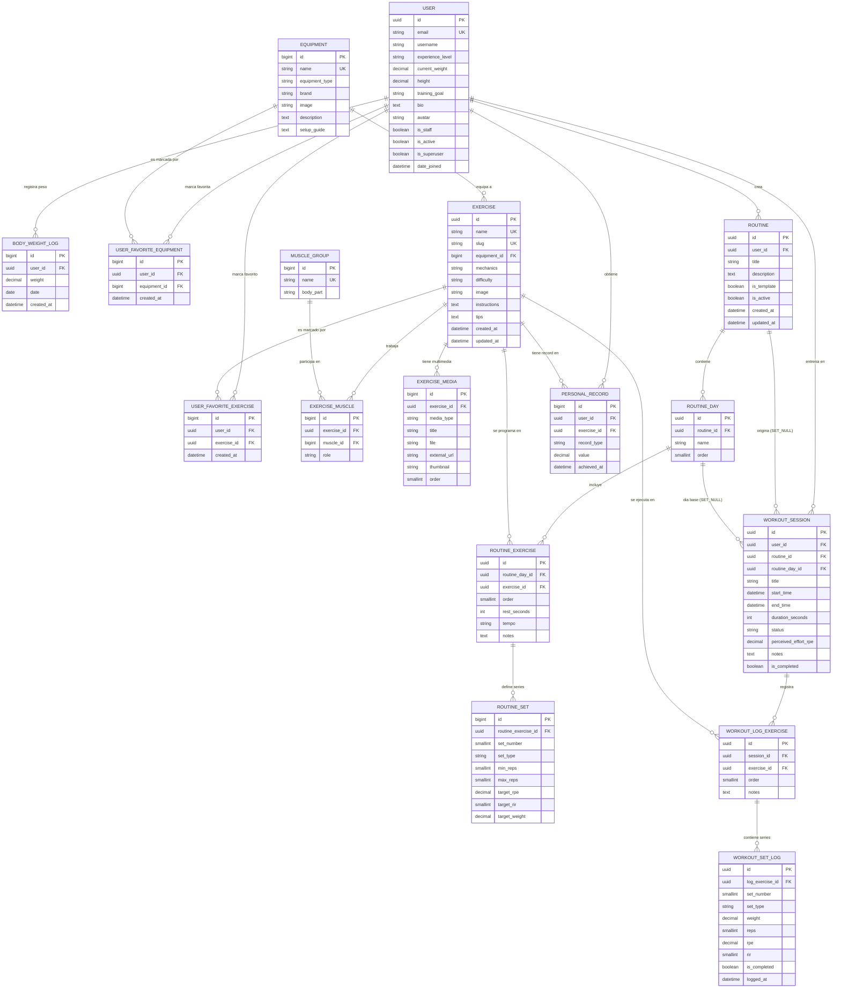

# 02. Base de Datos, Modelos y Diagrama Entidad-Relación — Apex Gym Hub

---

## 1. Propósito

Este documento describe el diseño completo de la base de datos relacional de **Apex Gym Hub** en SQLite (`db.sqlite3`) gestionada a través del ORM de Django. Detalla los **17 modelos** distribuidos en las 4 aplicaciones del sistema (`users`, `catalog`, `routines`, `tracking`), sus claves primarias (UUID vs autoincrementales), sus relaciones `ForeignKey` y `ManyToManyField`, restricciones de unicidad, políticas `on_delete`, el **Diagrama Entidad-Relación completo en Mermaid** y el historial de migraciones existentes junto con sus inconsistencias detectadas.

---

## 2. Ubicación

Todos los archivos de modelos y migraciones se ubican bajo `c:\Users\idiaz\Music\Proyecto Final\GymProyecto_BackEnd\Gym_Backend\`:

- **Modelos:**
  - `apps/users/models.py` (2 modelos: `User`, `BodyWeightLog`)
  - `apps/catalog/models.py` (7 modelos: `Equipment`, `MuscleGroup`, `Exercise`, `ExerciseMuscle`, `ExerciseMedia`, `UserFavoriteEquipment`, `UserFavoriteExercise`)
  - `apps/routines/models.py` (4 modelos: `Routine`, `RoutineDay`, `RoutineExercise`, `RoutineSet`)
  - `apps/tracking/models.py` (4 modelos: `WorkoutSession`, `WorkoutLogExercise`, `WorkoutSetLog`, `PersonalRecord`)
- **Migraciones existentes:**
  - `apps/users/migrations/0001_initial.py`
  - `apps/users/migrations/0002_user_training_goal_bodyweightlog.py`
  - `apps/catalog/migrations/0001_initial.py`
  - `apps/catalog/migrations/0002_exercise_image_alter_equipment_image_and_more.py`
  - `apps/catalog/migrations/0003_userfavoriteexercise.py`
  - `apps/routines/migrations/0001_initial.py`
  - `apps/routines/migrations/0002_initial.py`
  - `apps/tracking/migrations/0001_initial.py`
  - `apps/tracking/migrations/0002_initial.py`
  - `apps/tracking/migrations/0003_workoutsession_routine_status_duration.py`

---

## 3. Cómo se conecta

Los modelos conforman cuatro capas interconectadas:

1. **Identidad y Biometría (`users`)**: `User` es el nodo central al que se vinculan logs de peso corporal (`BodyWeightLog`), favoritos del catálogo, rutinas personales, sesiones de entrenamiento y récords personales.
2. **Catálogo Maestro (`catalog`)**: Modela máquinas (`Equipment`), grupos musculares (`MuscleGroup`) y ejercicios (`Exercise`). Utiliza la tabla intermedia explícita `ExerciseMuscle` para clasificar el rol de cada músculo (`primary`, `secondary`, `stabilizer`) y tablas de unión `UserFavoriteEquipment` y `UserFavoriteExercise` para favoritos por usuario.
3. **Planificación (`routines`)**: Modela una jerarquía de 4 niveles: `Routine` → `RoutineDay` → `RoutineExercise` (apuntando a `catalog.Exercise`) → `RoutineSet`.
4. **Ejecución y Progreso (`tracking`)**: Registra entrenamientos reales vinculados opcionalmente a la planificación (`WorkoutSession` → `Routine` y `RoutineDay`) y al catálogo (`WorkoutLogExercise` → `Exercise` → `WorkoutSetLog`), además de almacenar marcas consolidadas en `PersonalRecord`.

### Diagrama Entidad-Relación (Mermaid `erDiagram`)



---

## 4. Componentes, funciones y variables clave (Detalle de los 17 modelos)

### 4.1 App `users` (`apps/users/models.py`) — 2 modelos

#### Modelo 1: `User` (hereda de `AbstractUser`)
| Campo | Tipo Django / SQL | Restricciones / Default | Descripción |
| :--- | :--- | :--- | :--- |
| `id` | `UUIDField` | `primary_key=True`, `default=uuid.uuid4`, `editable=False` | Identificador único universal. |
| `email` | `EmailField` | `unique=True`, `max_length=254` | Identificador de login (`USERNAME_FIELD`). |
| `username` | `CharField` | `max_length=50`, `blank=True`, `null=True` | Nombre visible opcional (no único). |
| `avatar` | `ImageField` | `upload_to='avatars/'`, `null=True`, `blank=True` | Foto de perfil. |
| `experience_level` | `CharField` | `max_length=20`, `choices`: `beginner`, `intermediate`, `advanced`; `default='beginner'` | Nivel de experiencia del usuario. |
| `current_weight` | `DecimalField` | `max_digits=5`, `decimal_places=2`, `null=True`, `blank=True` | Peso corporal actual en kg (sincronizado con `BodyWeightLog`). |
| `height` | `DecimalField` | `max_digits=5`, `decimal_places=2`, `null=True`, `blank=True` | Estatura en cm (`verbose_name='Estatura (cm)'`). |
| `training_goal` | `CharField` | `max_length=30`, `choices`: `hypertrophy`, `strength`, `weight_loss`, `endurance`, `general_fitness`; `default='hypertrophy'` | Objetivo de entrenamiento. |
| `bio` | `TextField` | `blank=True` | Biografía u objetivos libres. |
| *(Heredados de `AbstractUser`)* | `password`, `last_login`, `is_superuser`, `first_name`, `last_name`, `is_staff`, `is_active`, `date_joined`, `groups`, `user_permissions` | Estándar Django Auth | Campos de autenticación, permisos y fechas. |

#### Modelo 2: `BodyWeightLog`
| Campo | Tipo Django | Restricciones / Default | Descripción |
| :--- | :--- | :--- | :--- |
| `id` | `BigAutoField` | PK autoincremental | Identificador del registro. |
| `user` | `ForeignKey(User)` | `on_delete=CASCADE`, `related_name='weight_logs'` | Usuario dueño del pesaje. |
| `weight` | `DecimalField` | `max_digits=5`, `decimal_places=2` | Peso corporal en kg. |
| `date` | `DateField` | `default=timezone.localdate` | Fecha del pesaje. |
| `created_at` | `DateTimeField` | `auto_now_add=True` | Marca temporal de creación. |
| *Meta* | — | `ordering = ['-date', '-id']` | Del más reciente al más antiguo. |

---

### 4.2 App `catalog` (`apps/catalog/models.py`) — 7 modelos

#### Modelo 3: `Equipment`
| Campo | Tipo Django | Restricciones / Default | Descripción |
| :--- | :--- | :--- | :--- |
| `id` | `BigAutoField` | PK autoincremental | Identificador de la máquina. |
| `name` | `CharField` | `max_length=120`, `unique=True` | Nombre único del equipo/máquina. |
| `equipment_type` | `CharField` | `max_length=30`, `choices`: `plate_loaded`, `pin_selected`, `cable`, `smith`, `free_weight`, `bodyweight`, `cardio`, `accessory`; `default='plate_loaded'` | Clasificación técnica del equipo. |
| `brand` | `CharField` | `max_length=100`, `blank=True` | Fabricante (ej. Hammer Strength, Life Fitness). |
| `image` | `ImageField` | `upload_to='equipment/'`, `null=True`, `blank=True`, `validators=[validate_image]` | Foto optimizada automáticamente a WebP en `save()`. |
| `description` | `TextField` | `blank=True` | Descripción general. |
| `setup_guide` | `TextField` | `blank=True` | Guía de ajuste físico (asiento, rodillos, pernos). |
| *Meta* | — | `ordering = ['name']` | Orden alfabético. |

#### Modelo 4: `MuscleGroup`
| Campo | Tipo Django | Restricciones / Default | Descripción |
| :--- | :--- | :--- | :--- |
| `id` | `BigAutoField` | PK autoincremental | Identificador del músculo. |
| `name` | `CharField` | `max_length=80`, `unique=True` | Nombre del músculo (ej. `Cuádriceps`). |
| `body_part` | `CharField` | `max_length=50` | Zona anatómica (`Torso`, `Hombro`, `Brazo`, `Pierna`, `Core`). |
| *Meta* | — | `ordering = ['body_part', 'name']` | Orden por región anatómica y nombre. |

#### Modelo 5: `Exercise`
| Campo | Tipo Django | Restricciones / Default | Descripción |
| :--- | :--- | :--- | :--- |
| `id` | `UUIDField` | `primary_key=True`, `default=uuid.uuid4`, `editable=False` | Identificador UUID portable. |
| `name` | `CharField` | `max_length=150`, `unique=True` | Nombre único del ejercicio. |
| `slug` | `SlugField` | `max_length=160`, `unique=True`, `blank=True` | Generado con `slugify(self.name)` si está vacío en `save()`. |
| `equipment` | `ForeignKey(Equipment)` | `on_delete=SET_NULL`, `null=True`, `blank=True`, `related_name='exercises'` | Máquina asociada (opcional). |
| `muscles` | `ManyToManyField(MuscleGroup)` | `through='ExerciseMuscle'`, `related_name='exercises'` | Relación N:M explícita con rol muscular. |
| `mechanics` | `CharField` | `max_length=20`, `choices`: `compound`, `isolation`; `default='compound'` | Multiarticular o aislamiento. |
| `difficulty` | `CharField` | `max_length=20`, `choices`: `beginner`, `intermediate`, `advanced`; `default='beginner'` | Dificultad técnica. |
| `image` | `ImageField` | `upload_to='exercises/'`, `null=True`, `blank=True`, `validators=[validate_image]` | Imagen principal optimizada a WebP en `save()`. |
| `instructions` | `TextField` | Obligatorio | Pasos de ejecución. |
| `tips` | `TextField` | `blank=True` | Consejos y errores frecuentes. |
| `created_at` / `updated_at` | `DateTimeField` | `auto_now_add=True` / `auto_now=True` | Auditoría temporal. |

#### Modelo 6: `ExerciseMuscle`
| Campo | Tipo Django | Restricciones / Default | Descripción |
| :--- | :--- | :--- | :--- |
| `id` | `BigAutoField` | PK autoincremental | Identificador de relación. |
| `exercise` | `ForeignKey(Exercise)` | `on_delete=CASCADE`, `related_name='exercise_muscles'` | Ejercicio evaluado. |
| `muscle` | `ForeignKey(MuscleGroup)` | `on_delete=CASCADE`, `related_name='muscle_exercises'` | Músculo involucrado. |
| `role` | `CharField` | `max_length=20`, `choices`: `primary`, `secondary`, `stabilizer`; `default='primary'` | Función biomecánica. |
| *Meta* | — | `unique_together = ('exercise', 'muscle')` | Impide duplicar el mismo músculo en un ejercicio. |

#### Modelo 7: `ExerciseMedia`
| Campo | Tipo Django | Restricciones / Default | Descripción |
| :--- | :--- | :--- | :--- |
| `id` | `BigAutoField` | PK autoincremental | Identificador del recurso. |
| `exercise` | `ForeignKey(Exercise)` | `on_delete=CASCADE`, `related_name='media'` | Ejercicio asociado. |
| `media_type` | `CharField` | `max_length=10`, `choices`: `image`, `video`, `gif`; `default='video'` | Tipo de medio. |
| `title` | `CharField` | `max_length=100`, `blank=True` | Título o vista (ej. Vista lateral). |
| `file` | `FileField` | `upload_to='exercises/media/'`, `null=True`, `blank=True` | Archivo subido localmente. |
| `external_url` | `URLField` | `blank=True` | URL externa (YouTube, Vimeo, CDN). |
| `thumbnail` | `ImageField` | `upload_to='exercises/thumbnails/'`, `null=True`, `blank=True` | Miniatura de respaldo. |
| `order` | `PositiveSmallIntegerField` | `default=0` | Orden de despliegue (`ordering = ['order', 'id']`). |

#### Modelo 8: `UserFavoriteEquipment`
| Campo | Tipo Django | Restricciones / Default | Descripción |
| :--- | :--- | :--- | :--- |
| `id` | `BigAutoField` | PK autoincremental | Identificador del favorito. |
| `user` | `ForeignKey(AUTH_USER_MODEL)` | `on_delete=CASCADE`, `related_name='favorite_equipment'` | Usuario. |
| `equipment` | `ForeignKey(Equipment)` | `on_delete=CASCADE`, `related_name='favorited_by'` | Máquina marcada. |
| `created_at` | `DateTimeField` | `auto_now_add=True` | Fecha en que se marcó. |
| *Meta* | — | `unique_together = ('user', 'equipment')`, `ordering = ['-created_at']` | Un favorito único por usuario y máquina. |

#### Modelo 9: `UserFavoriteExercise`
| Campo | Tipo Django | Restricciones / Default | Descripción |
| :--- | :--- | :--- | :--- |
| `id` | `BigAutoField` | PK autoincremental | Identificador del favorito. |
| `user` | `ForeignKey(AUTH_USER_MODEL)` | `on_delete=CASCADE`, `related_name='favorite_exercises_set'` | Usuario. |
| `exercise` | `ForeignKey(Exercise)` | `on_delete=CASCADE`, `related_name='favorited_by'` | Ejercicio marcado. |
| `created_at` | `DateTimeField` | `auto_now_add=True` | Fecha en que se marcó. |
| *Meta* | — | `unique_together = ('user', 'exercise')`, `ordering = ['-created_at']` | Un favorito único por usuario y ejercicio. |

---

### 4.3 App `routines` (`apps/routines/models.py`) — 4 modelos

#### Modelo 10: `Routine`
| Campo | Tipo Django | Restricciones / Default | Descripción |
| :--- | :--- | :--- | :--- |
| `id` | `UUIDField` | `primary_key=True`, `default=uuid.uuid4`, `editable=False` | Identificador UUID de la rutina. |
| `user` | `ForeignKey(AUTH_USER_MODEL)` | `on_delete=CASCADE`, `related_name='routines'`, `null=True`, `blank=True` | Creador (`null` posible en plantillas globales). |
| `title` | `CharField` | `max_length=150` | Nombre de la rutina. |
| `description` | `TextField` | `blank=True` | Descripción u objetivos. |
| `is_template` | `BooleanField` | `default=False` | Si `True`, es plantilla visible por todos. |
| `is_active` | `BooleanField` | `default=True` | Indicador de vigencia. |
| `created_at` / `updated_at` | `DateTimeField` | `auto_now_add=True` / `auto_now=True` | Auditoría (`ordering = ['-created_at']`). |

#### Modelo 11: `RoutineDay`
| Campo | Tipo Django | Restricciones / Default | Descripción |
| :--- | :--- | :--- | :--- |
| `id` | `UUIDField` | `primary_key=True`, `default=uuid.uuid4`, `editable=False` | Identificador UUID del día. |
| `routine` | `ForeignKey(Routine)` | `on_delete=CASCADE`, `related_name='days'` | Rutina padre. |
| `name` | `CharField` | `max_length=80` | Nombre del día (ej. `Día 1`). |
| `order` | `PositiveSmallIntegerField` | `default=1` | Posición semanal (`ordering = ['order']`). |

#### Modelo 12: `RoutineExercise`
| Campo | Tipo Django | Restricciones / Default | Descripción |
| :--- | :--- | :--- | :--- |
| `id` | `UUIDField` | `primary_key=True`, `default=uuid.uuid4`, `editable=False` | Identificador UUID de la asignación. |
| `routine_day` | `ForeignKey(RoutineDay)` | `on_delete=CASCADE`, `related_name='exercises'` | Día padre. |
| `exercise` | `ForeignKey(Exercise)` | `on_delete=CASCADE`, `related_name='routine_placements'` *(en `models.py`)* | Ejercicio del catálogo *(ver nota de migraciones abajo)*. |
| `order` | `PositiveSmallIntegerField` | `default=1` | Orden de ejecución (`ordering = ['order']`). |
| `rest_seconds` | `PositiveIntegerField` | `default=90` | Descanso sugerido en segundos. |
| `tempo` | `CharField` | `max_length=20`, `blank=True` | Cadencia (ej. `3-1-1-0`). |
| `notes` | `TextField` | `blank=True` | Indicaciones técnicas. |

#### Modelo 13: `RoutineSet`
| Campo | Tipo Django | Restricciones / Default | Descripción |
| :--- | :--- | :--- | :--- |
| `id` | `BigAutoField` | PK autoincremental | Identificador de serie objetivo. |
| `routine_exercise` | `ForeignKey(RoutineExercise)` | `on_delete=CASCADE`, `related_name='target_sets'` | Ejercicio de rutina padre. |
| `set_number` | `PositiveSmallIntegerField` | `default=1` | Número de serie (`ordering = ['set_number']`). |
| `set_type` | `CharField` | `max_length=20`, `choices`: `warmup`, `feeder`, `working`, `drop_set`, `to_failure`; `default='working'` | Categoría de serie. |
| `min_reps` / `max_reps` | `PositiveSmallIntegerField` | `default=8` / `default=12` | Rango de repeticiones objetivo. |
| `target_rpe` | `DecimalField` | `max_digits=3`, `decimal_places=1`, `null=True`, `blank=True` | Esfuerzo percibido objetivo (1-10). |
| `target_rir` | `PositiveSmallIntegerField` | `null=True`, `blank=True` | Repeticiones en recámara objetivo. |
| `target_weight` | `DecimalField` | `max_digits=6`, `decimal_places=2`, `null=True`, `blank=True` | Peso sugerido (kg). |

---

### 4.4 App `tracking` (`apps/tracking/models.py`) — 4 modelos

#### Modelo 14: `WorkoutSession`
| Campo | Tipo Django | Restricciones / Default | Descripción |
| :--- | :--- | :--- | :--- |
| `id` | `UUIDField` | `primary_key=True`, `default=uuid.uuid4`, `editable=False` | Identificador UUID de la sesión. |
| `user` | `ForeignKey(AUTH_USER_MODEL)` | `on_delete=CASCADE`, `related_name='workout_sessions'` | Usuario que entrena. |
| `routine` | `ForeignKey(Routine)` | `on_delete=SET_NULL`, `null=True`, `blank=True`, `related_name='workout_sessions'` | Rutina ejecutada (preserva historial si se borra la rutina). |
| `routine_day` | `ForeignKey(RoutineDay)` | `on_delete=SET_NULL`, `null=True`, `blank=True`, `related_name='workout_sessions'` | Día de rutina ejecutado. |
| `title` | `CharField` | `max_length=150`, `blank=True` | Título de la sesión. |
| `start_time` | `DateTimeField` | `default=timezone.now` | Inicio (`ordering = ['-start_time']`). |
| `end_time` | `DateTimeField` | `null=True`, `blank=True` | Fin de la sesión. |
| `duration_seconds` | `PositiveIntegerField` | `null=True`, `blank=True` | Duración calculada al finalizar. |
| `status` | `CharField` | `max_length=20`, `choices`: `active`, `completed`, `cancelled`; `default='active'` | Estado del ciclo de vida. |
| `perceived_effort_rpe` | `DecimalField` | `max_digits=3`, `decimal_places=1`, `null=True`, `blank=True` | RPE global de la sesión. |
| `notes` | `TextField` | `blank=True` | Sensaciones / notas. |
| `is_completed` | `BooleanField` | `default=False` | Bandera booleana de completado. |
| *(Propiedades Python)* | `started_at`, `ended_at` | `@property` + `@setter` | Alias compatibles hacia `start_time` y `end_time`. |

#### Modelo 15: `WorkoutLogExercise`
| Campo | Tipo Django | Restricciones / Default | Descripción |
| :--- | :--- | :--- | :--- |
| `id` | `UUIDField` | `primary_key=True`, `default=uuid.uuid4`, `editable=False` | Identificador UUID. |
| `session` | `ForeignKey(WorkoutSession)` | `on_delete=CASCADE`, `related_name='logged_exercises'` | Sesión padre. |
| `exercise` | `ForeignKey(Exercise)` | `on_delete=CASCADE`, `related_name='logged_workouts'` *(en `models.py`)* | Ejercicio ejecutado *(ver nota de migraciones)*. |
| `order` | `PositiveSmallIntegerField` | `default=1` | Orden (`ordering = ['order']`). |
| `notes` | `TextField` | `blank=True` | Notas del ejercicio. |

#### Modelo 16: `WorkoutSetLog`
| Campo | Tipo Django | Restricciones / Default | Descripción |
| :--- | :--- | :--- | :--- |
| `id` | `UUIDField` | `primary_key=True`, `default=uuid.uuid4`, `editable=False` | Identificador UUID. |
| `log_exercise` | `ForeignKey(WorkoutLogExercise)` | `on_delete=CASCADE`, `related_name='logged_sets'` | Ejercicio registrado padre. |
| `set_number` | `PositiveSmallIntegerField` | `default=1` | Número de serie (`ordering = ['set_number']`). |
| `set_type` | `CharField` | `max_length=20`, `default='working'` | Tipo de serie (texto libre con default `'working'`). |
| `weight` | `DecimalField` | `max_digits=6`, `decimal_places=2` | Peso levantado (kg). |
| `reps` | `PositiveSmallIntegerField` | Obligatorio | Repeticiones logradas. |
| `rpe` | `DecimalField` | `max_digits=3`, `decimal_places=1`, `null=True`, `blank=True` | Esfuerzo percibido. |
| `rir` | `PositiveSmallIntegerField` | `null=True`, `blank=True` | Repeticiones en reserva. |
| `is_completed` | `BooleanField` | `default=True` | Si la serie cuenta como completada. |
| `logged_at` | `DateTimeField` | `auto_now_add=True` | Fecha/hora exacta de registro. |
| *(Propiedad Python)* | `estimated_1rm` | `@property` | Fórmula de Brzycki sobre `weight` y `reps`. |

#### Modelo 17: `PersonalRecord`
| Campo | Tipo Django | Restricciones / Default | Descripción |
| :--- | :--- | :--- | :--- |
| `id` | `BigAutoField` | PK autoincremental | Identificador del récord. |
| `user` | `ForeignKey(AUTH_USER_MODEL)` | `on_delete=CASCADE`, `related_name='records'` | Usuario propietario. |
| `exercise` | `ForeignKey(Exercise)` | `on_delete=CASCADE`, `related_name='user_records'` | Ejercicio del récord. |
| `record_type` | `CharField` | `max_length=30` | Tipo (`'max_weight'`, `'1rm'`, etc.). |
| `value` | `DecimalField` | `max_digits=8`, `decimal_places=2` | Valor récord registrado. |
| `achieved_at` | `DateTimeField` | `auto_now_add=True` | Fecha en que se alcanzó. |
| *Meta* | — | `unique_together = ('user', 'exercise', 'record_type')` | Un único registro vigente por usuario, ejercicio y tipo de récord. |

---

## 5. Explicación del código línea por línea o bloque por bloque (Migraciones reales)

### 5.1 Patrón de migración inicial dividida (`0001_initial.py` + `0002_initial.py`)

En `apps/routines/migrations/` y `apps/tracking/migrations/`, Django generó automáticamente **dos archivos iniciales** (`0001_initial.py` y `0002_initial.py`) el `2026-10-21`:

```python
# apps/routines/migrations/0002_initial.py (fragmento líneas 12-43)
    dependencies = [
        ('catalog', '0001_initial'),
        ('routines', '0001_initial'),
        migrations.swappable_dependency(settings.AUTH_USER_MODEL),
    ]

    operations = [
        migrations.AddField(
            model_name='routine',
            name='user',
            field=models.ForeignKey(..., to=settings.AUTH_USER_MODEL, ...),
        ),
        # ...
        migrations.AddField(
            model_name='routineexercise',
            name='exercise',
            field=models.ForeignKey(on_delete=django.db.models.deletion.PROTECT, related_name='routine_placements', to='catalog.exercise'),
        ),
```

- **¿Por qué se dividió?** Para evitar dependencias circulares al crear tablas iniciales: `0001_initial.py` crea las tablas y campos propios sin llaves foráneas inter-app, y `0002_initial.py` agrega las llaves foráneas una vez que `users` y `catalog` ya existen.
- **Hallazgo crítico de código vs migraciones:** Tanto en `apps/routines/migrations/0002_initial.py` (línea 32) como en `apps/tracking/migrations/0002_initial.py` (línea 28), los campos `RoutineExercise.exercise` y `WorkoutLogExercise.exercise` fueron migrados con `on_delete=django.db.models.deletion.PROTECT`. Posteriormente, en `apps/routines/models.py` (línea 50) y `apps/tracking/models.py` (línea 86), se cambiaron a `on_delete=models.CASCADE`, **pero no se generó una migración nueva (`makemigrations`)** que refleje ese cambio. Esto explica además por qué `ExerciseViewSet.perform_destroy` borra manualmente ambos conjuntos dentro de `transaction.atomic()` antes de llamar a `instance.delete()`.

### 5.2 Migraciones evolutivas (`0002_*` y `0003_*`)

1. **`apps/users/migrations/0002_user_training_goal_bodyweightlog.py`:**
   - Añade `User.training_goal` (default `'hypertrophy'`) para no romper filas existentes.
   - Crea el modelo `BodyWeightLog`.
2. **`apps/catalog/migrations/0002_exercise_image_alter_equipment_image_and_more.py`:**
   - Añade `Exercise.image` con `validators=[apps.catalog.models.validate_image]`.
   - Altera `Equipment.image` para incorporar el mismo validador.
   - Crea `UserFavoriteEquipment` con `unique_together = {('user', 'equipment')}`.
3. **`apps/catalog/migrations/0003_userfavoriteexercise.py`:**
   - Crea `UserFavoriteExercise` con `unique_together = {('user', 'exercise')}`.
4. **`apps/tracking/migrations/0003_workoutsession_routine_status_duration.py`:**

```python
def sync_existing_sessions(apps, schema_editor):
    WorkoutSession = apps.get_model('tracking', 'WorkoutSession')
    WorkoutSession.objects.filter(is_completed=True).update(status='completed')
    WorkoutSession.objects.filter(
        title='Entrenamiento Móvil',
        is_completed=False,
        routine__isnull=True,
    ).update(status='cancelled')
```

- **Migración de datos (`RunPython`):** Además de añadir `routine`, `duration_seconds` y `status` (y cambiar `start_time` a `default=timezone.now`), ejecuta `sync_existing_sessions` usando `apps.get_model(...)` (el estado histórico del modelo durante la migración) para reconciliar sesiones antiguas: las que tenían `is_completed=True` pasan a `status='completed'` y las sesiones huérfanas heredadas llamadas `'Entrenamiento Móvil'` se marcan `'cancelled'`. Usa `migrations.RunPython.noop` como operación inversa.

---

## 6. Flujo paso a paso (Cómo evoluciona el esquema y cómo interactúan las llaves)

1. Un administrador registra máquinas (`Equipment`), músculos (`MuscleGroup`) y ejercicios (`Exercise` + `ExerciseMuscle` + `ExerciseMedia`).
2. Un usuario se registra (`User`), opcionalmente registra su peso corporal (`BodyWeightLog`) y marca favoritos (`UserFavoriteEquipment`, `UserFavoriteExercise`).
3. El usuario crea o clona una `Routine` → `RoutineDay` → `RoutineExercise` (enlazado a `Exercise`) → `RoutineSet`.
4. Al entrenar, se crea una `WorkoutSession` (con `SET_NULL` hacia `Routine` y `RoutineDay` para no perder historial si luego edita o borra su rutina).
5. Durante la sesión, cada ejercicio realizado crea un `WorkoutLogExercise` y sus series en `WorkoutSetLog`. Al guardar cada serie, se actualiza automáticamente `PersonalRecord` si el peso supera el máximo previo para `(user, exercise, 'max_weight')`.

---

## 7. Conceptos y términos técnicos

- **UUID (`uuid.uuid4`) vs `BigAutoField`:** El UUID es un identificador alfanumérico de 128 bits prácticamente imposible de colisionar o adivinar secuencialmente; se usa en entidades principales/distribuidas (`User`, `Exercise`, `Routine`, `WorkoutSession`). `BigAutoField` es un entero autoincremental de 64 bits más ligero para tablas auxiliares o de unión (`BodyWeightLog`, `Equipment`, `RoutineSet`, `PersonalRecord`).
- **Tabla intermedia explícita (`through='ExerciseMuscle'`):** En lugar de dejar que Django cree una tabla M2M invisible de dos columnas, se declara el modelo `ExerciseMuscle` para guardar atributos extra en la relación (el campo `role`: agonista, sinergista o estabilizador).
- **Políticas `on_delete` (`CASCADE` vs `SET_NULL` vs `PROTECT`):**
  - `CASCADE`: Al borrar el padre (ej. un `User` o `Routine`), borra automáticamente sus hijos dependientes.
  - `SET_NULL`: Al borrar la `Routine`, mantiene las `WorkoutSession` históricas del usuario dejando `routine = NULL`.
  - `PROTECT`: Impide borrar un registro referenciado mientras existan hijos apuntando a él.
- **Migración de esquema vs Migración de datos (`RunPython`):** La primera altera tablas y columnas (`AddField`, `CreateModel`); `RunPython` ejecuta código Python seguro sobre los registros existentes para poblar o transformar datos acorde a las nuevas reglas.
- **`unique_together`:** Índice compuesto en base de datos que garantiza que la combinación de columnas no se repita (ej. un usuario no puede tener duplicado el mismo ejercicio en favoritos).

---

## 8. Posibles preguntas del profesor

1. **¿Por qué algunos modelos usan `UUIDField` como clave primaria y otros usan `BigAutoField`?**
   - *Respuesta modelo:* Se usa `UUIDField` en entidades centrales y expuestas en URLs de usuario/negocio (`User`, `Exercise`, `Routine`, `RoutineDay`, `RoutineExercise`, `WorkoutSession`, `WorkoutLogExercise`, `WorkoutSetLog`) para evitar enumeración secuencial de IDs y permitir generación descentralizada. Tablas catálogo pequeñas, de unión o dependientes simples (`Equipment`, `MuscleGroup`, `BodyWeightLog`, `RoutineSet`, `PersonalRecord`, favoritos) usan `BigAutoField` por menor peso en índices y simplicidad.

2. **¿Por qué `WorkoutSession` usa `on_delete=models.SET_NULL` hacia `Routine` y `RoutineDay` en lugar de `CASCADE`?**
   - *Respuesta modelo:* Porque el historial de entrenamientos realizados es un registro histórico real del usuario. Si un usuario elimina o cambia una plantilla o rutina planificada, borrar en cascada destruiría sus marcas pasadas, récords y métricas de volumen; `SET_NULL` preserva la sesión conservando su `title` y sus series registradas.

3. **¿Para qué sirve `through='ExerciseMuscle'` en el campo `Exercise.muscles`?**
   - *Respuesta modelo:* Una relación `ManyToManyField` estándar solo uniría `exercise_id` y `muscle_id`. Con `through='ExerciseMuscle'` agregamos semántica de dominio mediante el campo `role` (`primary`, `secondary`, `stabilizer`) y aseguramos mediante `unique_together = ('exercise', 'muscle')` que un mismo músculo no sea asignado dos veces al mismo ejercicio.

4. **¿Qué detecta un análisis técnico al comparar `models.py` con `migrations/` en `routines` y `tracking`?**
   - *Respuesta modelo:* Se detecta que `RoutineExercise.exercise` y `WorkoutLogExercise.exercise` están declarados en `models.py` con `on_delete=models.CASCADE`, pero sus migraciones (`0002_initial.py` en ambas apps) los tienen registrados con `on_delete=models.PROTECT`, sin una migración posterior generada. En un flujo limpio de Django hay que generar esas migraciones pendientes.

5. **¿Qué hace `sync_existing_sessions` en la migración `0003` de `tracking` y por qué usa `apps.get_model`?**
   - *Respuesta modelo:* Recorre sesiones antiguas ya guardadas en la base de datos para sincronizar el nuevo campo `status`: marca `status='completed'` donde `is_completed=True` y `status='cancelled'` en sesiones fantasma previas tituladas `'Entrenamiento Móvil'` sin rutina. Usa `apps.get_model('tracking', 'WorkoutSession')` en lugar de importar la clase directamente porque durante una migración el código actual de `models.py` podría estar adelantado respecto al estado histórico de las tablas en ese paso.

6. **¿Cómo garantiza la base de datos que un usuario no duplique sus favoritos o sus récords personales?**
   - *Respuesta modelo:* Mediante restricciones `unique_together` en `Meta`: `('user', 'equipment')` en `UserFavoriteEquipment`, `('user', 'exercise')` en `UserFavoriteExercise`, `('exercise', 'muscle')` en `ExerciseMuscle` y `('user', 'exercise', 'record_type')` en `PersonalRecord`. Esto impone integridad a nivel de motor SQL, no solo en Python.

---

## 9. Resumen para repasar

- El esquema cuenta exactamente con **17 modelos** repartidos en `users` (**2**), `catalog` (**7**), `routines` (**4**) y `tracking` (**4**).
- La tabla `ExerciseMuscle` implementa una relación N:M con rol anatómico (`primary`, `secondary`, `stabilizer`), mientras que `PersonalRecord` y las tablas de favoritos usan `unique_together` para garantizar unicidad.
- El historial de entrenamiento (`WorkoutSession`) se protege con `SET_NULL` frente a eliminaciones de rutinas, pero guarda registros hijos en cascada (`WorkoutLogExercise` → `WorkoutSetLog`).
- Existen **10 archivos de migración** aplicados en el proyecto; destacan `tracking/0003` con migración de datos (`RunPython`) y la deuda técnica de que `routines` y `tracking` tienen cambios `PROTECT` → `CASCADE` en `models.py` sin migración generada.
