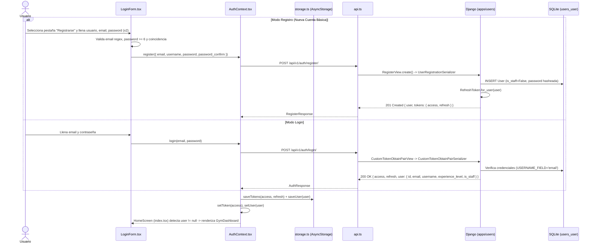
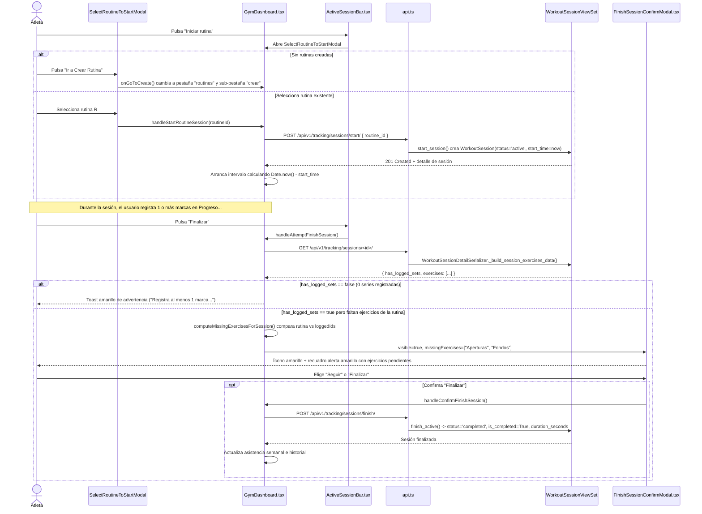
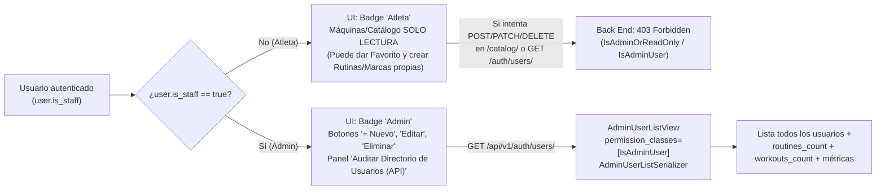

# Flujos Transversales Punta a Punta (Front End ↔ API ↔ Back End ↔ Base de Datos)

Este documento describe **de punta a punta** los **6 flujos transversales más importantes de Apex Gym Hub**, mostrando exactamente qué archivos de React Native, qué peticiones HTTP de `api.ts`, qué vistas/serializadores de Django y qué tablas de SQLite intervienen en cada operación.

---

## Flujo 1: Inicio de Sesión, Registro Básico (`is_staff = false`) y Ciclo de Tokens JWT

### Participantes reales
- **Front End:** [LoginForm.tsx](file:///C:/Users/idiaz/Music/Proyecto%20Final/GymProyecto_FrontEnd/src/components/auth/LoginForm.tsx), [AuthContext.tsx](file:///C:/Users/idiaz/Music/Proyecto%20Final/GymProyecto_FrontEnd/src/context/AuthContext.tsx), [storage.ts](file:///C:/Users/idiaz/Music/Proyecto%20Final/GymProyecto_FrontEnd/src/services/storage.ts), [api.ts](file:///C:/Users/idiaz/Music/Proyecto%20Final/GymProyecto_FrontEnd/src/services/api.ts), [index.tsx](file:///C:/Users/idiaz/Music/Proyecto%20Final/GymProyecto_FrontEnd/src/app/index.tsx).
- **Back End:** [apps/users/urls.py](file:///C:/Users/idiaz/Music/Proyecto%20Final/GymProyecto_BackEnd/Gym_Backend/apps/users/urls.py), [apps/users/views.py](file:///C:/Users/idiaz/Music/Proyecto%20Final/GymProyecto_BackEnd/Gym_Backend/apps/users/views.py), [apps/users/serializers.py](file:///C:/Users/idiaz/Music/Proyecto%20Final/GymProyecto_BackEnd/Gym_Backend/apps/users/serializers.py), [apps/users/models.py](file:///C:/Users/idiaz/Music/Proyecto%20Final/GymProyecto_BackEnd/Gym_Backend/apps/users/models.py).

### Detalle importante de restauración de sesión y tokens
1. Cuando la app se abre nuevamente, `AuthProvider` ejecuta `loadSavedSession()` en `useEffect`.
2. Lee `@gym_access_token` y `@gym_user_data` de `AsyncStorage`. Si existe token, muestra temporalmente el usuario guardado y consulta `GET /api/v1/auth/profile/` (`UserProfileView`) para validar que el token siga vigente y traer datos actualizados del servidor.
3. **Nota técnica honesta para defensa:** Aunque el backend expone `POST /api/v1/auth/token/refresh/` (`TokenRefreshView` con `ROTATE_REFRESH_TOKENS = True`) y `storage.ts` guarda `refreshToken`, `request()` en `api.ts` actualmente **no** intercepta errores `401` para renovarlos en segundo plano; si `getProfile()` falla al arrancar, `loadSavedSession()` invoca `logout()` y regresa al login. En compensación de desarrollo, `SIMPLE_JWT['ACCESS_TOKEN_LIFETIME']` está configurado a `7 días`.

---

## Flujo 2: Crear Rutina, Iniciar Sesión Activa y Finalizar con Alerta Amarilla

### Participantes reales
- **Front End:** [CreateRoutineCard.tsx](file:///C:/Users/idiaz/Music/Proyecto%20Final/GymProyecto_FrontEnd/src/components/dashboard/routines/CreateRoutineCard.tsx), [muscleValidation.ts](file:///C:/Users/idiaz/Music/Proyecto%20Final/GymProyecto_FrontEnd/src/components/dashboard/muscleValidation.ts), [SelectRoutineToStartModal.tsx](file:///C:/Users/idiaz/Music/Proyecto%20Final/GymProyecto_FrontEnd/src/components/dashboard/routines/SelectRoutineToStartModal.tsx), [ActiveSessionBar.tsx](file:///C:/Users/idiaz/Music/Proyecto%20Final/GymProyecto_FrontEnd/src/components/dashboard/routines/ActiveSessionBar.tsx), [GymDashboard.tsx](file:///C:/Users/idiaz/Music/Proyecto%20Final/GymProyecto_FrontEnd/src/components/dashboard/GymDashboard.tsx), [FinishSessionConfirmModal.tsx](file:///C:/Users/idiaz/Music/Proyecto%20Final/GymProyecto_FrontEnd/src/components/dashboard/routines/FinishSessionConfirmModal.tsx).
- **Back End:** [apps/routines/views.py](file:///C:/Users/idiaz/Music/Proyecto%20Final/GymProyecto_BackEnd/Gym_Backend/apps/routines/views.py), [apps/tracking/views.py](file:///C:/Users/idiaz/Music/Proyecto%20Final/GymProyecto_BackEnd/Gym_Backend/apps/tracking/views.py), [apps/tracking/serializers.py](file:///C:/Users/idiaz/Music/Proyecto%20Final/GymProyecto_BackEnd/Gym_Backend/apps/tracking/serializers.py).

### Puntos clave del flujo
- Si el atleta crea una rutina desde la pestaña `Rutinas → Crear`, `handleCreateRoutine` valida el nombre, filtra los ejercicios compatibles con `newRoutineFocus` mediante `isExerciseCompatibleWithFocus`, envía `POST /api/v1/routines/routines/` (`perform_create` crea en `transaction.atomic()` la `Routine`, su `'Día 1'`, los `RoutineExercise` y las `RoutineSet` objetivo) y dispara un toast con `code: "routine_created"`, el cual hace que `GymDashboard` cambie automáticamente a `Mis Rutinas`.
- El cronómetro en `GymDashboard.tsx` nunca depende de incrementar `+1` por segundo en memoria sin referencia: cada tick ejecuta `computeElapsedSeconds(activeSession)` contra `started_at`, de modo que aunque el celular bloquee la pantalla o cierre la app, `restoreActiveSession()` al reabrir consulta `/tracking/sessions/active/` y continúa con la hora exacta.

---

## Flujo 3: Registro de Marcas, Cálculo de 1RM (Brzycki), PR y Gráfica SVG

### Participantes reales
- **Front End:** [MarcaFormCard.tsx](file:///C:/Users/idiaz/Music/Proyecto%20Final/GymProyecto_FrontEnd/src/components/dashboard/tracking/MarcaFormCard.tsx), [useGymDashboardData.ts](file:///C:/Users/idiaz/Music/Proyecto%20Final/GymProyecto_FrontEnd/src/hooks/useGymDashboardData.ts), [RMTrackingChart.tsx](file:///C:/Users/idiaz/Music/Proyecto%20Final/GymProyecto_FrontEnd/src/components/dashboard/tracking/RMTrackingChart.tsx), [MarcaHistoryList.tsx](file:///C:/Users/idiaz/Music/Proyecto%20Final/GymProyecto_FrontEnd/src/components/dashboard/tracking/MarcaHistoryList.tsx).
- **Back End:** [apps/tracking/models.py](file:///C:/Users/idiaz/Music/Proyecto%20Final/GymProyecto_BackEnd/Gym_Backend/apps/tracking/models.py), [apps/tracking/views.py](file:///C:/Users/idiaz/Music/Proyecto%20Final/GymProyecto_BackEnd/Gym_Backend/apps/tracking/views.py).

### Paso a paso
1. **Desbloqueo:** En `GymDashboard.tsx`, `canRegisterMarca = Boolean(activeSession !== null)`. Si no hay sesión activa, la pestaña Progreso muestra una tarjeta de candado (`lockStateCard`). Al iniciar sesión, se desbloquea `MarcaFormCard`.
2. **Guardado encadenado (`api.saveMarca`):** Cuando el atleta presiona **Guardar Marca**, `useGymDashboardData.handleSaveMarca()` valida peso y reps y llama a `api.saveMarca(exerciseId, w, r, rpe)`:
   - Llama `ensureSession()`: busca `GET /tracking/sessions/` una sesión no completada (`!s.is_completed`) o crea una como respaldo.
   - Llama `POST /api/v1/tracking/exercises/` para crear/asociar `WorkoutLogExercise(session, exercise, order: 1)`.
   - Llama `POST /api/v1/tracking/sets/` con `{ log_exercise, set_number: 1, weight, reps, rpe }`.
3. **Procesamiento en Django (`WorkoutSetLogViewSet.perform_create`):**
   - Guarda `WorkoutSetLog` en SQLite.
   - Al serializar respuesta, `WorkoutSetLogSerializer` incluye `estimated_1rm` calculado en la propiedad del modelo con Brzycki: `weight * (36 / (37 - reps))`.
   - Consulta `PersonalRecord.objects.filter(user, exercise, record_type='max_weight').first()` y, si `weight > current_max.value`, actualiza o crea el récord personal (`update_or_create`).
4. **Actualización inmediata de interfaz:**
   - `GymDashboard` añade `trackingExerciseId` a `sessionLoggedExerciseIds` e incrementa `sessionMarcasCount`.
   - `handleSaveMarca` recarga `GET /api/v1/tracking/progression/<exercise_id>/` (`ExerciseProgressionView`).
   - `RMTrackingChart` recalcula el máximo histórico (`bestRM`), el porcentaje de progreso (`deltaPct`) entre la primera y última marca, y transforma cada punto `(x, y)` para dibujar el área degradada (`<Polygon>` + `<LinearGradient>`) y línea (`<Polyline>`) en SVG.

---

## Flujo 4: Sistema de Favoritos (UI Optimista + Subconsulta SQL `Exists`)

### Participantes reales
- **Front End:** [EquipmentSection.tsx](file:///C:/Users/idiaz/Music/Proyecto%20Final/GymProyecto_FrontEnd/src/components/dashboard/equipment/EquipmentSection.tsx), [CatalogSection.tsx](file:///C:/Users/idiaz/Music/Proyecto%20Final/GymProyecto_FrontEnd/src/components/dashboard/catalog/CatalogSection.tsx), [useGymDashboardData.ts](file:///C:/Users/idiaz/Music/Proyecto%20Final/GymProyecto_FrontEnd/src/hooks/useGymDashboardData.ts).
- **Back End:** [apps/catalog/views.py](file:///C:/Users/idiaz/Music/Proyecto%20Final/GymProyecto_BackEnd/Gym_Backend/apps/catalog/views.py), [apps/catalog/models.py](file:///C:/Users/idiaz/Music/Proyecto%20Final/GymProyecto_BackEnd/Gym_Backend/apps/catalog/models.py).

### Paso a paso
1. **Lectura eficiente (sin problema N+1):** Cuando se cargan máquinas (`GET /catalog/equipment/`) o ejercicios (`GET /catalog/exercises/`), los ViewSets en Django anotan cada registro en la misma consulta SQL mediante `Exists(UserFavoriteEquipment.objects.filter(user=user, equipment=OuterRef('pk')))` (o `UserFavoriteExercise`). El serializador expone el booleano `is_favorite`.
2. **UI Optimista al tocar el corazón:**
   - `handleToggleEquipmentFavorite` o `handleToggleExerciseFavorite` invoca una vibración corta (`Vibration.vibrate(15)`).
   - **Antes** de esperar al servidor, invierte `is_favorite` en el estado local (`setEquipmentList` / `setExercises`), logrando respuesta instantánea para el usuario.
3. **Persistencia tipo Toggle en Django:**
   - Envía `POST /api/v1/catalog/equipment/<id>/favorite/` o `POST /api/v1/catalog/exercises/<id>/favorite/`.
   - El `@action toggle_favorite` (accesible a cualquier usuario autenticado, incluso no admin) ejecuta `UserFavorite*.objects.get_or_create(user=request.user, ...)`. Si ya existía (`created == False`), lo borra y responde `{ is_favorite: false }`; si no existía, lo crea con `201 Created` y responde `{ is_favorite: true }`.
4. **Confirmación o Rollback:** El frontend sincroniza el valor oficial retornado por el servidor; si hay error de red, revierte `is_favorite` a su estado anterior y muestra un toast de error.

---

## Flujo 5: Perfil Biométrico, Estatura en Metros, IMC y Gráfica Dual Peso vs 1RM

### Participantes reales
- **Front End:** [ProfileSection.tsx](file:///C:/Users/idiaz/Music/Proyecto%20Final/GymProyecto_FrontEnd/src/components/dashboard/profile/ProfileSection.tsx), [EditProfileForm.tsx](file:///C:/Users/idiaz/Music/Proyecto%20Final/GymProyecto_FrontEnd/src/components/dashboard/profile/EditProfileForm.tsx).
- **Back End:** [apps/users/views.py](file:///C:/Users/idiaz/Music/Proyecto%20Final/GymProyecto_BackEnd/Gym_Backend/apps/users/views.py), [apps/tracking/views.py](file:///C:/Users/idiaz/Music/Proyecto%20Final/GymProyecto_BackEnd/Gym_Backend/apps/tracking/views.py).

### Paso a paso
1. **Normalización segura de estatura (metros vs centímetros heredados):**
   - Aunque el modelo Django originalmente anotaba `verbose_name='Estatura (cm)'`, la app muestra y edita la estatura en **metros** (`1.60 m`).
   - En `ProfileSection.tsx`, `normalizeHeightToMeters()` detecta si un valor es `> 3` (por ejemplo, un registro antiguo guardado como `175` cm) y lo divide entre `100` (`1.75 m`); si es `<= 3` lo deja tal cual. Luego calcula el IMC con la fórmula estándar $\text{IMC} = \frac{\text{peso}}{\text{estatura}^2}$ redondeado a 1 decimal (`.toFixed(1)`).
   - En `EditProfileForm.tsx`, `parseHeightMeters()` acepta tanto metros (`0.50` a `2.80`) como entradas en centímetros (`50` a `280`, normalizándolas a metros antes de enviar `.toFixed(2)`).
2. **Guardado de perfil + sincronización de historial de peso:**
   - Al guardar en `EditProfileForm`, se envía `PATCH /api/v1/auth/profile/`. Si cambió el peso respecto a `user.current_weight`, también llama `POST /api/v1/auth/weight-logs/` para agregar un punto en `BodyWeightLog`.
   - De forma inversa, cuando el usuario registra un nuevo peso desde la tarjeta biométrica inferior en `ProfileSection` (`handleAddWeightLog`), `BodyWeightLogListCreateView.perform_create` actualiza automáticamente `request.user.current_weight` con el registro más reciente.
3. **Cruce Peso Corporal vs 1RM (`Weight1RMProgressView`):**
   - `ProfileSection` consulta `GET /api/v1/tracking/progress/weight-1rm/` (opcionalmente filtrado por `exercise_id`).
   - Django recorre cada `WorkoutSetLog` completado del usuario, ubica la fecha local correspondiente y busca con `get_body_weight_at(local_date)` el último `BodyWeightLog` igual o anterior a esa fecha (o usa `user.current_weight`), calculando `estimated_1rm` y `relative_strength`.
   - Finalmente, `ProfileSection` renderiza dos `<Polyline>` SVG superpuestas: curva de **1RM** (trazo sólido en color primario) y curva de **Peso Corporal** (trazo punteado gris).

---

## Flujo 6: Roles, Permisos (`is_staff`) y Auditoría de Usuarios (Admin)

### Participantes reales
- **Front End:** [DashboardHeader.tsx](file:///C:/Users/idiaz/Music/Proyecto%20Final/GymProyecto_FrontEnd/src/components/dashboard/DashboardHeader.tsx), [GymDashboard.tsx](file:///C:/Users/idiaz/Music/Proyecto%20Final/GymProyecto_FrontEnd/src/components/dashboard/GymDashboard.tsx), [EquipmentSection.tsx](file:///C:/Users/idiaz/Music/Proyecto%20Final/GymProyecto_FrontEnd/src/components/dashboard/equipment/EquipmentSection.tsx), [CatalogSection.tsx](file:///C:/Users/idiaz/Music/Proyecto%20Final/GymProyecto_FrontEnd/src/components/dashboard/catalog/CatalogSection.tsx), [ProfileSection.tsx](file:///C:/Users/idiaz/Music/Proyecto%20Final/GymProyecto_FrontEnd/src/components/dashboard/profile/ProfileSection.tsx).
- **Back End:** [apps/catalog/permissions.py](file:///C:/Users/idiaz/Music/Proyecto%20Final/GymProyecto_BackEnd/Gym_Backend/apps/catalog/permissions.py), [apps/users/views.py](file:///C:/Users/idiaz/Music/Proyecto%20Final/GymProyecto_BackEnd/Gym_Backend/apps/users/views.py), [apps/users/serializers.py](file:///C:/Users/idiaz/Music/Proyecto%20Final/GymProyecto_BackEnd/Gym_Backend/apps/users/serializers.py).

### Doble barrera de protección
1. **Catálogo Oficial (Máquinas, Músculos, Ejercicios, Media):**
   - `EquipmentViewSet`, `MuscleGroupViewSet`, `ExerciseViewSet` y `ExerciseMediaViewSet` heredan `permission_classes = [IsAdminOrReadOnly]`: lectura pública/autenticada en `GET`/`HEAD`/`OPTIONS`, pero creación/edición/eliminación restringida a `user.is_staff == True`. Las excepciones explícitas con `@action(..., permission_classes=[permissions.IsAuthenticated])` son únicamente `favorite` y `favorites`, para que todo atleta pueda guardar sus máquinas y ejercicios favoritos sin tener permisos de administrador.
   - En el cliente, `canManageItem` y `requireAdmin()` garantizan que ni desde la interfaz ni mediante pulsación larga (`onLongPress`) un atleta acceda a formularios administrativos.
2. **Auditoría de Directorio de Usuarios:**
   - Sólo visible en `ProfileSection.tsx` cuando `user?.is_staff && !isEditing`.
   - Al tocar **"Auditar Directorio de Usuarios (API)"**, `useGymDashboardData.loadAdminUsers()` verifica `requireAdmin()`, invoca `GET /api/v1/auth/users/` (`AdminUserListView`), y despliega la lista de cuentas registradas con su rol (`shield` o `user`), correo/username y estado (`is_active` / `status`).
