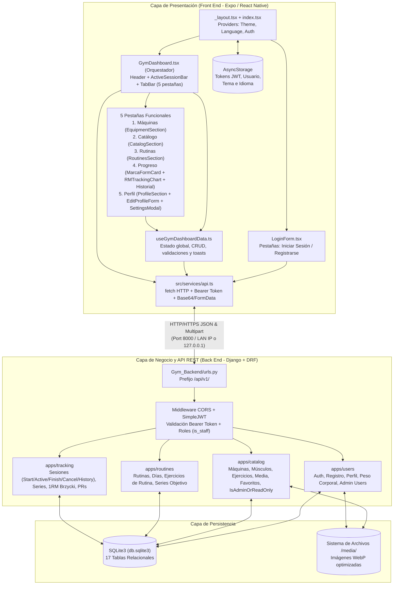

# Documentación Técnica Final — **Apex Gym Hub**

> **Guía integral de estudio y defensa oral (Front End, Back End, Arquitectura y Base de Datos)**  
> Proyecto: **Apex Gym Hub** (`GymProyecto_FrontEnd` + `GymProyecto_BackEnd`)

---

## 1. Descripción General del Proyecto y Objetivos

**Apex Gym Hub** es una aplicación móvil y web multiplataforma para la gestión integral de entrenamiento físico en gimnasio, construida bajo una arquitectura **cliente-servidor desacoplada** con un **Front End en React Native / Expo** y un **Back End en Django / Django REST Framework**.

### Objetivos del sistema
1. **Digitalizar el catálogo oficial del gimnasio:** permitir a los usuarios consultar todas las máquinas y ejercicios disponibles (con foto, guía de ajuste, músculos trabajados, dificultad, mecánica e instrucciones), y a los administradores gestionarlos de forma segura.
2. **Planificar rutinas personalizadas con validación anatómica:** crear rutinas enfocadas por grupo muscular (`pecho`, `espalda`, `pierna`, `hombro`, `brazo`, `core`, `fullbody`), validando la compatibilidad muscular de los ejercicios agregados y configurando series y rangos de repeticiones objetivo.
3. **Registrar entrenamientos en tiempo real:** controlar sesiones activas con cronómetro persistente (resistente a segundo plano o reinicio de la app), impedir finalizar entrenamientos sin marcas, advertir con una alerta visual en amarillo qué ejercicios quedaron pendientes de registrar series, y almacenar el historial completo.
4. **Medir la progresión de fuerza y biometría:** calcular automáticamente el **1RM estimado (Repetición Máxima)** mediante la fórmula científica de **Brzycki**, detectar récords personales (`PersonalRecord`), graficar curvas de evolución de fuerza (`RMTrackingChart`) y cruzar el historial de peso corporal del atleta con su fuerza relativa (`1RM / peso corporal`) y su **IMC (Índice de Masa Corporal)**.
5. **Controlar permisos por rol:** diferenciar estrictamente al **Atleta (usuario básico, `is_staff = false`)** —quien puede registrarse por sí mismo, ver máquinas y ejercicios en modo solo lectura, marcar favoritos y gestionar sus propias rutinas y marcas— del **Administrador del Gimnasio (`is_staff = true`)** —quien administra el inventario del gimnasio y cuenta con la herramienta de auditoría **"Auditar Directorio de Usuarios (API)"**—.
6. **Experiencia adaptable e internacionalizada:** ofrecer tema dinámico (`Oscuro`, `Claro` o `Sistema`) con 5 paletas de acento combinables y soporte bilingüe en vivo (`Español`, `Inglés` o `Sistema`), persistidos localmente en el dispositivo.

---

## 2. Stack Tecnológico

### Front End (`GymProyecto_FrontEnd`)
| Tecnología / Paquete | Versión (`package.json`) | Para qué se usa en Apex Gym Hub |
| :--- | :--- | :--- |
| **React** | `19.3.0` | Motor declarativo de interfaz de usuario basado en componentes, hooks (`useState`, `useEffect`, `useMemo`, `useCallback`, `useRef`) y Context API. |
| **React Native** | `0.88.0` | Framework nativo multiplataforma (`View`, `Text`, `Pressable`, `Modal`, `ScrollView`, `RefreshControl`, `Animated`, `AppState`, `Vibration`). |
| **Expo** | `~58.0.17` | Plataforma y tooling de compilación/desarrollo para ejecutar un mismo código TypeScript en Android, iOS y Web (`react-native-web`). |
| **Expo Router** | `~58.0.25` | Punto de entrada (`src/app/_layout.tsx` y `src/app/index.tsx`) e integración con `ThemeProvider` de navegación. |
| **TypeScript** | `~6.0.3` (`strict: true`) | Tipado estático estricto en modelos de API, props de componentes, tokens de tema y diccionarios de traducción. |
| **AsyncStorage** (`@react-native-async-storage/async-storage`) | `2.2.0` | Almacenamiento local persistente para tokens JWT (`@gym_access_token`, `@gym_refresh_token`), datos de usuario (`@gym_user_data`) y preferencias de tema/idioma (`@apex_gym_preferences`). |
| **react-native-svg** | `15.16.0` | Dibujo vectorial nítido de los más de 50 íconos (`GymIcon.tsx`) y de las gráficas interactivas de evolución 1RM y Peso Corporal (`RMTrackingChart.tsx`, `ProfileSection.tsx`). |
| **expo-image** | `~58.0.16` | Renderizado optimizado de imágenes de perfil, máquinas y ejercicios con política de caché `memory-disk`. |
| **expo-image-picker** / **expo-image-manipulator** | `^58.0.10` / `^58.0.16` | Captura desde cámara o galería, recorte, redimensionado a máx. `1080px` y compresión a JPEG/WebP (`quality: 0.7`) con salida Base64/File. |
| **expo-constants**, **expo-system-ui**, **expo-status-bar** | `~58.0.x` | Detección automática de la IP LAN del servidor Metro para conectar dispositivos físicos al backend y sincronización nativa de la barra de estado y fondo. |

### Back End (`GymProyecto_BackEnd/Gym_Backend`)
| Tecnología / Paquete | Uso dentro del proyecto |
| :--- | :--- |
| **Python 3 + Django** (`6.1` según encabezados `wsgi.py`/`asgi.py`) | Framework web MVC/MVT que gestiona configuración, ORM relacional, migraciones, panel administrativo `/admin/` y comandos CLI (`seed_catalog`). |
| **Django REST Framework (DRF)** | Construcción de la API RESTful bajo `/api/v1/` mediante `ModelViewSet`, `APIView`, `generics`, serializadores, paginación (`PageNumberPagination`, `PAGE_SIZE = 20`), parsers multiparte/JSON y filtros de búsqueda. |
| **djangorestframework-simplejwt** | Autenticación stateless mediante JSON Web Tokens (`JWTAuthentication`) con encabezado `Bearer`, `ACCESS_TOKEN_LIFETIME` de 7 días, `REFRESH_TOKEN_LIFETIME` de 30 días y rotación automática de refresh tokens (`ROTATE_REFRESH_TOKENS = True`). |
| **django-cors-headers** | Middleware (`CorsMiddleware`) que habilita peticiones Cross-Origin desde clientes web (Expo Web) y dispositivos móviles hacia el backend. |
| **Pillow (`PIL`)** | Procesamiento de imágenes en el servidor: validación, corrección automática de orientación EXIF (`ImageOps.exif_transpose`), redimensionado a máximo `1080x1080` y conversión automática a formato eficiente **WebP** (`quality=75`, `optimize=True`). |
| **SQLite3 (`db.sqlite3`)** | Base de datos relacional embebida con 17 modelos distribuidos en 4 aplicaciones de dominio (`users`, `catalog`, `routines`, `tracking`). |

---

## 3. Diagrama de Arquitectura del Sistema



---

## 4. Índice Propuesto y Guía de Estudio (Orden Recomendado)

Este es el índice maestro de toda la documentación generada. Se recomienda estudiarlo siguiendo este orden numérico para comprender primero los fundamentos del servidor y los datos, luego la estructura base del cliente, después las pantallas y finalmente los flujos transversales:

### Visión Global y Flujos Ponta a Punta
| Documento | Contenido y archivos del proyecto cubiertos | Enlace |
| :--- | :--- | :--- |
| **Guía Maestra (este archivo)** | Arquitectura, stack, instalación, glosario y 20 preguntas globales para defensa oral. | [README.md](./README.md) |
| **Flujos Transversales** | 6 flujos punta a punta Front ↔ Back (Auth/JWT, Sesiones con Alerta Amarilla, 1RM/PR, Favoritos, Perfil/IMC y Roles Admin). | [FLUJOS-TRANSVERSALES-PUNTA-A-PUNTA.md](./FLUJOS-TRANSVERSALES-PUNTA-A-PUNTA.md) |

### Back End (`documentos/Documentacion final/Back end/`)
| # | Archivo | Qué cubre exactamente | Enlace |
| :-: | :--- | :--- | :--- |
| 01 | **Configuración y Arquitectura** | `manage.py`, `Gym_Backend/settings.py`, `urls.py`, `wsgi.py`, `asgi.py`, `templates/index.html`. | [01-estructura-configuracion-y-arquitectura-django.md](./Back%20end/01-estructura-configuracion-y-arquitectura-django.md) |
| 02 | **Base de Datos y Diagrama ER** | Los 17 modelos en `apps/{users,catalog,routines,tracking}/models.py`, migraciones y diagrama ER Mermaid. | [02-base-de-datos-modelos-y-diagrama-er.md](./Back%20end/02-base-de-datos-modelos-y-diagrama-er.md) |
| 03 | **Autenticación JWT y Roles** | `apps/users/*` (`CustomUserManager`, `RegisterView`, `CustomTokenObtainPairSerializer`, `AdminUserListView`, `BodyWeightLog`) y `apps/catalog/permissions.py` (`IsAdminOrReadOnly`). | [03-autenticacion-jwt-usuarios-y-roles-admin.md](./Back%20end/03-autenticacion-jwt-usuarios-y-roles-admin.md) |
| 04 | **Catálogo y Multimedia** | `apps/catalog/*` (máquinas, músculos, ejercicios, `FlexibleImageField` Base64/multipart, optimización WebP Pillow, favoritos con `Exists` y `seed_catalog.py`). | [04-modulo-catalogo-maquinas-ejercicios-y-multimedia.md](./Back%20end/04-modulo-catalogo-maquinas-ejercicios-y-multimedia.md) |
| 05 | **Rutinas, Días y Series** | `apps/routines/*` (`RoutineViewSet`, creación con `Día 1`, `add_exercise`, `clone_routine`, algoritmo diferencial de series e `IsRoutineExerciseOwner`). | [05-modulo-rutinas-dias-y-series-objetivo.md](./Back%20end/05-modulo-rutinas-dias-y-series-objetivo.md) |
| 06 | **Tracking, Sesiones y 1RM** | `apps/tracking/*` (`WorkoutSessionViewSet`, paginación con resumen, `estimated_1rm` Brzycki, `PersonalRecord`, `ExerciseProgressionView`, `Weight1RMProgressView`). | [06-modulo-tracking-sesiones-1rm-y-progreso.md](./Back%20end/06-modulo-tracking-sesiones-1rm-y-progreso.md) |
| 07 | **Catálogo de Endpoints y Auditoría** | Tabla maestra de todos los endpoints REST `/api/v1/`, validaciones, errores HTTP y riesgos/deuda técnica detectados. | [07-catalogo-completo-endpoints-validaciones-y-errores.md](./Back%20end/07-catalogo-completo-endpoints-validaciones-y-errores.md) |

### Front End (`documentos/Documentacion final/Front end/`)
| # | Archivo | Qué cubre exactamente | Enlace |
| :-: | :--- | :--- | :--- |
| 01 | **Estructura y Configuración** | `package.json`, `app.json`, `tsconfig.json`, `.env.example`, `src/app/_layout.tsx`, `src/app/index.tsx`, `explore.tsx`, `animated-icon.*`. | [01-estructura-general-y-configuracion.md](./Front%20end/01-estructura-general-y-configuracion.md) |
| 02 | **Navegación y Dashboard** | `GymDashboard.tsx`, `DashboardHeader.tsx`, `DashboardTabBar.tsx`, `dashboardStyles.ts`, `types.ts` (5 pestañas, roles, cronómetro, sync, alerta de cierre). | [02-navegacion-y-orquestador-dashboard.md](./Front%20end/02-navegacion-y-orquestador-dashboard.md) |
| 03 | **Estado Global y Storage** | `AuthContext.tsx`, `ThemeContext.tsx`, `LanguageContext.tsx`, `storage.ts`, `preferences.ts`, `useGymDashboardData.ts`. | [03-estado-global-contextos-y-almacenamiento.md](./Front%20end/03-estado-global-contextos-y-almacenamiento.md) |
| 04 | **Cliente API HTTP** | `src/services/api.ts` (detección de IP LAN, `request<T>`, `ApiError`, `pickAndCompressImage`, `serializePayloadWithImage`, `resolveExerciseImageUrl`). | [04-cliente-api-y-comunicacion-http.md](./Front%20end/04-cliente-api-y-comunicacion-http.md) |
| 05 | **Temas, UI Atómica e i18n** | `theme.ts` (oscuro/claro/sistema + 5 acentos), `components/ui/*` (`GymIcon`, `AppButton`, `AppInput`, `AnimatedCard`, `AnimatedToast`) y `src/i18n/*`. | [05-estilos-temas-componentes-ui-e-i18n.md](./Front%20end/05-estilos-temas-componentes-ui-e-i18n.md) |
| 06 | **Autenticación (Login/Registro)** | `LoginForm.tsx` (pestañas Iniciar Sesión / Registrarse, validaciones, auto-login) y `UserProfileCard.tsx` (componente legado). | [06-autenticacion-login-y-registro.md](./Front%20end/06-autenticacion-login-y-registro.md) |
| 07 | **Pestaña Máquinas** | `equipment/EquipmentSection.tsx`, `equipment/AddEquipmentModal.tsx` (filtros biomecánicos, favoritos, solo lectura para atletas). | [07-pestana-maquinas-equipment.md](./Front%20end/07-pestana-maquinas-equipment.md) |
| 08 | **Pestaña Catálogo** | `catalog/CatalogSection.tsx`, `AddExerciseModal.tsx`, `ExerciseDetailModal.tsx`, `muscleValidation.ts`. | [08-pestana-catalogo-ejercicios.md](./Front%20end/08-pestana-catalogo-ejercicios.md) |
| 09 | **Pestaña Rutinas y Sesión** | Todo `routines/*` (`RoutinesSection`, `MyRoutinesSubTab`, `CreateRoutineCard`, `RoutineCard`, `RoutineDetailView`, `ActiveSessionBar`, `FinishSessionConfirmModal`, `WeeklyAttendanceCard`, etc.). | [09-pestana-rutinas-y-sesion-activa.md](./Front%20end/09-pestana-rutinas-y-sesion-activa.md) |
| 10 | **Pestaña Progreso y 1RM** | Todo `tracking/*` (`MarcaFormCard`, `RMTrackingChart`, `MarcaHistoryList`, `RoutineSessionHistorySection`). | [10-pestana-progreso-marcas-y-graficas-1rm.md](./Front%20end/10-pestana-progreso-marcas-y-graficas-1rm.md) |
| 11 | **Perfil, Ajustes y Modales CRUD** | `profile/*` (`ProfileSection`, `EditProfileForm`, `SettingsModal`) y `modals/*` (`ConfirmDeleteModal`, `ItemActionSheet`, `EditItemModal` + `edit-forms/*`). | [11-pestana-perfil-imc-ajustes-y-modales-crud.md](./Front%20end/11-pestana-perfil-imc-ajustes-y-modales-crud.md) |

---

## 5. Cómo Instalar y Ejecutar el Proyecto

### 5.1 Requisitos Previos
- **Python 3.11+** (el código del proyecto usa encabezados compatibles con Django 6.1).
- **Node.js 18+** y **npm**.
- Dispositivo físico con **Expo Go** (en la misma red Wi-Fi que la PC) o navegador web moderno / emulador Android o iOS.

### 5.2 Puesta en Marcha del Back End (`GymProyecto_BackEnd\Gym_Backend`)
> **Nota importante:** el repositorio no incluye un archivo `requirements.txt`, por lo que las dependencias detectadas directamente en `settings.py` y `models.py` deben instalarse manualmente en un entorno virtual.

```powershell
# 1. Ir a la carpeta del backend
cd "c:\Users\idiaz\Music\Proyecto Final\GymProyecto_BackEnd\Gym_Backend"

# 2. Crear y activar entorno virtual (Windows PowerShell)
python -m venv .venv
.\.venv\Scripts\Activate.ps1

# 3. Instalar paquetes requeridos por settings.py y catalog/models.py
pip install django djangorestframework djangorestframework-simplejwt django-cors-headers pillow

# 4. Aplicar migraciones a la base de datos SQLite (db.sqlite3)
python manage.py migrate

# 5. (Opcional) Poblar catálogo base de músculos, máquinas y ejercicios
python manage.py seed_catalog

# 6. (Opcional) Crear un superusuario administrador si es una base nueva
python manage.py createsuperuser

# 7. Levantar el servidor escuchando en todas las interfaces de red (0.0.0.0)
# Necesario para que celulares en el mismo Wi-Fi se conecten
python manage.py runserver 0.0.0.0:8000
```
- Panel web rápido de demostración del backend: `http://127.0.0.1:8000/` (`templates/index.html`).
- Panel de administración Django: `http://127.0.0.1:8000/admin/`.

### 5.3 Puesta en Marcha del Front End (`GymProyecto_FrontEnd`)
```powershell
# 1. Ir a la carpeta del frontend
cd "c:\Users\idiaz\Music\Proyecto Final\GymProyecto_FrontEnd"

# 2. Instalar dependencias definidas en package.json
npm install

# 3. Configurar la IP local de tu PC en .env (para pruebas en celular Android/iOS)
# Ejemplo de contenido del archivo .env:
# EXPO_PUBLIC_DEV_PC_IP=192.168.100.8
```
> En **Web**, `src/services/api.ts` usa automáticamente `http://127.0.0.1:8000/api/v1`. En **Android/iOS**, usa `EXPO_PUBLIC_DEV_PC_IP` si existe en `.env`, o intenta extraer la IP de `Constants.expoConfig.hostUri`.

```powershell
# 4. Iniciar servidor de desarrollo de Expo
npx expo start

# Atajos útiles en la consola de Expo:
# - Pulsa "w" para abrir la versión Web
# - Escanea el código QR con Expo Go en Android o Cámara en iOS
```

---

## 6. Glosario General de Términos Técnicos

| Término | Definición sencilla para explicar al profesor |
| :--- | :--- |
| **API REST** | Interfaz de comunicación sobre HTTP que expone recursos (`/exercises/`, `/routines/`) y los manipula con verbos estándar (`GET` leer, `POST` crear, `PATCH` actualizar parcial, `DELETE` borrar). |
| **Endpoint** | Dirección URL específica del servidor que realiza una acción concreta (ej. `POST /api/v1/tracking/sessions/start/`). |
| **JSON** | Formato de texto ligero clave-valor usado para enviar y recibir datos estructurados entre la app móvil y Django. |
| **JWT (JSON Web Token)** | Token digital firmado criptográficamente por el servidor al iniciar sesión. Permite verificar la identidad del usuario en cada petición sin guardar sesiones en memoria del servidor (*stateless*). |
| **Access Token vs Refresh Token** | El **Access Token** es la credencial de uso diario que se envía en la cabecera `Authorization: Bearer <token>` (en este proyecto dura 7 días). El **Refresh Token** sirve para pedir un nuevo Access Token cuando caduca (dura 30 días). |
| **CORS** | Política de seguridad de los navegadores web (*Cross-Origin Resource Sharing*) que bloquea peticiones a otro puerto/dominio (ej. frontend `:8081` → backend `:8000`) salvo que el servidor las autorice vía `django-cors-headers`. |
| **Middleware** | Capa de software en Django que intercepta cada petición antes de llegar a la vista y cada respuesta antes de salir (ej. `CorsMiddleware`, `AuthenticationMiddleware`). |
| **ORM (Object-Relational Mapping)** | Capa de Django que traduce clases Python (`models.py`) a tablas SQL en SQLite y métodos como `.filter()` o `.create()` a sentencias SQL sin escribir SQL a mano. |
| **Serializer (DRF)** | Traductor y validador en Django REST Framework: valida JSON/archivos entrantes al servidor y convierte objetos del ORM a JSON saliente (y viceversa). |
| **ViewSet & Router** | Clase de DRF (`ModelViewSet`) que agrupa automáticamente listar, crear, ver detalle, editar y borrar en un solo lugar, generando sus rutas automáticamente con `DefaultRouter`. |
| **Hook (React)** | Función especial (`useState`, `useEffect`, `useMemo`, `useCallback`, `useRef`) que permite a componentes funcionales manejar estado y ciclo de vida. |
| **Custom Hook** | Hook creado por el desarrollador (`useGymDashboardData`) para sacar toda la lógica de negocio y llamadas API fuera de los componentes visuales. |
| **Context API** | Mecanismo nativo de React (`AuthContext`, `ThemeContext`, `LanguageContext`) para compartir datos globales sin pasar *props* manualmente por 5 niveles (*prop drilling*). |
| **Props vs State** | **Props** son argumentos inmutables que un padre pasa a un hijo; **State** (`useState`) es la memoria interna cambiante de un componente. |
| **AsyncStorage** | Almacenamiento local asíncrono clave-valor en React Native que persiste datos aunque el usuario cierre completamente la app. |
| **Multipart FormData vs Base64** | Formas de subir fotos: `FormData` envía el archivo binario por partes estándar HTTP; `Base64` convierte los bytes de la imagen en texto ASCII dentro de un JSON (soportado por `FlexibleImageField` en el backend para máxima compatibilidad Web/Móvil). |
| **Fórmula de Brzycki (1RM)** | Ecuación fisiológica para estimar el peso máximo que un atleta levantaría a 1 repetición: `1RM = peso × (36 / (37 - repeticiones))` (para `< 37` reps). |
| **Fuerza Relativa** | Cociente `estimated_1rm / peso_corporal` que mide qué tan fuerte es el atleta respecto a su propio peso. |
| **IMC (Índice de Masa Corporal)** | Métrica biométrica `peso (kg) / (estatura en metros)²`. |
| **Transacción Atómica (`@transaction.atomic`)** | Bloque de operaciones en base de datos que sigue la regla "todo o nada": si falla un paso intermedio, se revierte todo (`rollback`) para evitar datos huérfanos. |
| **Subconsulta `Exists(OuterRef)`** | Técnica SQL eficiente en el ORM de Django para saber en una sola consulta si cada máquina o ejercicio tiene favorito del usuario actual, evitando el problema de consultas N+1. |
| **UI Optimista** | Patrón visual (usado al dar "Me gusta" / favorito) donde la pantalla cambia el corazón de inmediato al tocarlo y revierte el cambio si la petición HTTP falla. |
| **Barrel File (`export *`)** | Archivo puente de una sola línea que re-exporta otro archivo movido a una subcarpeta para mantener compatibilidad sin romper imports. |

---

## 7. Las 20 Preguntas Más Probables del Profesor (con Respuestas Modelo)

### 1. ¿Cuál es la arquitectura general de "Apex Gym Hub" y por qué separaron Front End y Back End?
**Respuesta modelo:**  
Utilizamos una arquitectura **cliente-servidor desacoplada basada en API REST**. El Back End (Django + DRF + SQLite) encapsula todas las reglas de negocio, seguridad, cálculo de 1RM, procesamiento de imágenes y persistencia; mientras el Front End (React Native + Expo + TypeScript) consume los endpoints `/api/v1/` mediante HTTP JSON/Multipart y renderiza la experiencia en Android, iOS y Web. Separarlos permite que múltiples clientes (app móvil, navegador web y hasta un prototipo HTML administrativo en `templates/index.html`) compartan una única fuente de verdad y reglas de seguridad centralizadas.

### 2. ¿Cómo funciona la autenticación de usuarios y qué mecanismo usan para mantener la sesión abierta?
**Respuesta modelo:**  
Usamos **JWT (JSON Web Tokens)** con la librería `djangorestframework-simplejwt`. En `User`, sustituimos el login tradicional de Django por `email` (`USERNAME_FIELD = 'email'`). Al iniciar sesión (`POST /api/v1/auth/login/`) o registrarse (`POST /api/v1/auth/register/`), el backend emite un par de tokens (`access` válido por 7 días y `refresh` válido por 30 días con rotación activada) junto con el objeto `user`. En el frontend, `AuthContext` guarda ambos tokens y el perfil en `AsyncStorage` mediante `storage.ts`. Cada petición HTTP en `api.ts` adjunta automáticamente el header `Authorization: Bearer <access_token>`.

### 3. ¿Dónde y cómo validan que un usuario normal (Atleta) NO pueda crear, editar ni borrar máquinas o ejercicios?
**Respuesta modelo:**  
La validación existe en **dos capas** (defensa en profundidad):
1. **En el Back End (seguridad real):** en `apps/catalog/permissions.py` definimos la clase `IsAdminOrReadOnly`, aplicada a `EquipmentViewSet`, `MuscleGroupViewSet`, `ExerciseViewSet` y `ExerciseMediaViewSet`. Cualquier método seguro (`GET`, `HEAD`, `OPTIONS`) se permite a lectura, pero los métodos de escritura (`POST`, `PUT`, `PATCH`, `DELETE`) exigen estrictamente `request.user.is_authenticated and request.user.is_staff`. Si un atleta intenta enviar una petición directa por Postman o curl, Django responde **HTTP 403 Forbidden**.
2. **En el Front End (experiencia de usuario):** en `GymDashboard.tsx`, `EquipmentSection.tsx`, `CatalogSection.tsx` y `useGymDashboardData.ts` evaluamos `isAdmin = Boolean(user?.is_staff)`, ocultando botones `+ Nuevo`, menús de acción (`ItemActionSheet`) y modales de edición/eliminación para usuarios básicos, además de validar `requireAdmin()` y `canManageItem()` antes de disparar llamadas destructivas.

### 4. ¿Para qué sirve la función "Auditar Directorio de Usuarios (API)" y cómo protege la privacidad?
**Respuesta modelo:**  
Es una vista exclusiva para el Administrador del Gimnasio en la pestaña **Perfil** (`ProfileSection.tsx`) que consume `GET /api/v1/auth/users/`. En el backend (`apps/users/views.py`), `AdminUserListView` tiene `permission_classes = [permissions.IsAdminUser]`, lo que garantiza que únicamente usuarios con `is_staff = True` puedan consultarlo. Utiliza `AdminUserListSerializer`, que expone métricas agregadas calculadas vía ORM (`routines_count` y `workouts_count`) junto con nivel, peso y estado activo, sin exponer jamás hashes de contraseñas ni tokens.

### 5. ¿Qué ocurre cuando una persona nueva se registra desde la pantalla de Login?
**Respuesta modelo:**  
En `LoginForm.tsx`, al cambiar a la pestaña **Registrarse**, el cliente valida usuario no vacío, formato de correo electrónico, longitud mínima de contraseña (6 caracteres) y coincidencia entre contraseña y confirmación. Luego llama `AuthContext.register()`, que dispara `POST /api/v1/auth/register/`. En el backend, `UserRegistrationSerializer` crea el usuario con `User.objects.create_user(...)` (con `is_staff=False` por defecto para que sea cuenta básica) y `RegisterView.create()` genera de inmediato tokens JWT (`RefreshToken.for_user(user)`). Con esos tokens, el frontend guarda la sesión en `AsyncStorage` e ingresa directamente al dashboard sin obligar al usuario a escribir sus credenciales dos veces.

### 6. ¿Cómo conecta el celular físico en Expo Go con el servidor Django que corre en la computadora?
**Respuesta modelo:**  
En desarrollo local, un teléfono físico no puede consultar `127.0.0.1` porque apuntaría al propio teléfono. Por eso `api.ts` implementa `resolveDevHostIp()`: en Web usa `http://127.0.0.1:8000/api/v1`, pero en Android e iOS prioriza la variable de entorno `.env` `EXPO_PUBLIC_DEV_PC_IP`, o en su defecto extrae automáticamente la IP LAN desde `Constants.expoConfig.hostUri` proporcionada por Expo. A su vez, Django debe ejecutarse con `runserver 0.0.0.0:8000` y `ALLOWED_HOSTS = ['*']` para aceptar conexiones desde la red Wi-Fi local.

### 7. ¿Por qué usaron llaves primarias `UUID` en lugar de enteros autoincrementales en `User`, `Exercise`, `Routine` y `WorkoutSession`?
**Respuesta modelo:**  
Los `UUIDField` generan identificadores universales únicos de 128 bits no predecibles. Esto aporta **seguridad** frente a ataques de enumeración (un usuario no puede adivinar `/routines/1`, `/routines/2` para intentar acceder a datos ajenos) y facilita la generación y sincronización sin colisiones. Otros modelos secundarios como `Equipment` o `BodyWeightLog` conservan `BigAutoField` secuencial donde el orden numérico o la simplicidad es suficiente.

### 8. ¿Cómo están modeladas las Rutinas en la base de datos y por qué hay 4 tablas relacionadas?
**Respuesta modelo:**  
En `apps/routines/models.py` aplicamos normalización relacional en cuatro niveles jerárquicos: `Routine` (título, descripción, enfoque/plantilla, propietario) → `RoutineDay` (división semanal ordenada por `order`) → `RoutineExercise` (ejercicios asignados a cada día con orden, descanso en segundos y notas) → `RoutineSet` (cada serie objetivo con rango `min_reps` a `max_reps`, tipo de serie y RPE/peso sugerido). Aunque en la app móvil actual el backend crea un `'Día 1'` inicial en `perform_create`, la estructura está preparada para rutinas divididas en múltiples días (Push/Pull/Legs, Torso/Pierna) con configuración individual por serie.

### 9. ¿Cómo evita el sistema que el usuario mezcle ejercicios incoherentes en una rutina con enfoque específico (por ejemplo, sentadilla en una rutina de Pecho)?
**Respuesta modelo:**  
Implementamos `muscleValidation.ts` (`isExerciseCompatibleWithFocus`) en el frontend. Evalúa en cascada: primero los músculos relacionados del ejercicio (`exercise.muscles` y su `body_part`), luego el músculo primario (`primary_muscle`) y finalmente un respaldo por palabras clave del nombre del ejercicio. Si la rutina es `fullbody`, acepta cualquier ejercicio; si tiene enfoque específico (`pecho`, `espalda`, `pierna`, etc.), filtra en los selectores y bloquea agregar ejercicios incompatibles mostrando un toast descriptivo de error.

### 10. ¿Cómo funciona la subida y optimización de imágenes desde la app hacia Django?
**Respuesta modelo:**  
Es un pipeline de optimización en dos puntas:
1. **Front End (`pickAndCompressImage` y `serializePayloadWithImage` en `api.ts`):** pide permisos, recorta, redimensiona a máximo `1080px` y comprime (`0.7`) en JPEG (móvil) o WebP (web), generando Data URI Base64 o archivo `File`.
2. **Back End (`FlexibleImageField` y `optimize_image` en `apps/catalog`):** `FlexibleImageField` acepta indistintamente `multipart/form-data` o strings Base64 (decodificados a `ContentFile`). Antes de guardar, `validate_image` verifica extensión (`.jpg`, `.png`, `.webp`) y tamaño máximo de 5 MB; luego `optimize_image` corrige orientación EXIF con Pillow, redimensiona a `1080x1080` y guarda siempre como **WebP optimizado**. Al actualizar o borrar (`post_delete`), elimina los archivos viejos del disco para no desperdiciar almacenamiento.

### 11. ¿Cómo calcula la aplicación el 1RM y dónde se ejecuta ese cálculo?
**Respuesta modelo:**  
Usamos la **fórmula de Brzycki**:
$$\text{1RM} = \text{peso} \times \frac{36}{37 - \text{reps}}$$
Para `< 37` repeticiones (si `reps >= 37` devuelve el mismo peso para evitar divisiones por cero o números negativos). El cálculo existe en `WorkoutSetLog.estimated_1rm` como `@property` en Python (`apps/tracking/models.py`) —usado al devolver logs, progresión y cruce peso/1RM— y también en el frontend (`RMTrackingChart.tsx` y `MarcaHistoryList.tsx`) para renderizar etiquetas inmediatas. Además, al crear una serie en `WorkoutSetLogViewSet.perform_create`, el backend actualiza automáticamente la tabla `PersonalRecord` si se supera el peso máximo (`max_weight`).

### 12. ¿Cómo mantienen el cronómetro de la sesión activa preciso aunque el usuario cierre la app o apague la pantalla?
**Respuesta modelo:**  
En lugar de incrementar un contador en memoria que se congelaría en segundo plano, el backend guarda la marca temporal real `start_time` en UTC al iniciar la sesión (`POST /tracking/sessions/start/`). En el frontend (`GymDashboard.tsx`), `computeElapsedSeconds` calcula en cada segundo `Math.floor((Date.now() - startMs) / 1000)` y usa `AppState` para detener el intervalo cuando la app pasa a segundo plano y recalcular instantáneamente desde `start_time` al volver al primer plano (`"active"`). Si se reinicia la app, `restoreActiveSession()` consulta `GET /tracking/sessions/active/` y retoma el cronómetro exacto sin perder segundos.

### 13. ¿Cómo implementaron las reglas al intentar finalizar una sesión de entrenamiento?
**Respuesta modelo:**  
Al presionar **"Finalizar"** en `ActiveSessionBar`, `handleAttemptFinishSession` en `GymDashboard.tsx` consulta en tiempo real al backend `GET /api/v1/tracking/sessions/<id>/` (`WorkoutSessionDetailSerializer`):
- Si `has_logged_sets` es `false` (0 marcas registradas en toda la sesión), bloquea el cierre y muestra un toast de advertencia (`marcaRequiredMsg`).
- Si hay al menos 1 serie registrada pero faltan ejercicios planeados de esa rutina sin marcas (`computeMissingExercisesForSession`), abre `FinishSessionConfirmModal` mostrando un **recuadro amarillo de advertencia** (`colors.warning` y `colors.warningGlow`) con la lista desplazable de los ejercicios faltantes, permitiendo al atleta elegir entre **Seguir** entrenando o **Finalizar** de todos modos.

### 14. ¿Qué pasa en el historial de progreso cuando un atleta borra una rutina o borra una sesión individual?
**Respuesta modelo:**  
En el modelo `WorkoutSession` (`apps/tracking/models.py`), la clave foránea hacia `Routine` tiene `on_delete=models.SET_NULL`, por lo que al eliminar una rutina desde PostgreSQL/SQLite sus sesiones históricas no se pierden ni lanzan errores de integridad (conservan su `title` guardado), y en el frontend `useGymDashboardData.handleConfirmDelete` re-selecciona automáticamente la siguiente rutina activa para sincronizar las gráficas y listas de levantamientos (`Lift History`). Además, agregamos eliminación individual de sesiones (`DELETE /api/v1/tracking/sessions/<id>/`) desde `RoutineSessionHistorySection` que refresca simultáneamente las métricas semanales, el resumen de sesiones y el historial de marcas.

### 15. ¿Cómo resolvieron el bug donde el IMC daba valores irreales y la estatura aparecía en centímetros en lugar de metros?
**Respuesta modelo:**  
Detectamos que `ProfileSection.tsx` dividía `peso / (estatura * estatura)` esperando metros, pero había datos heredados guardados en centímetros (ej. `160` en vez de `1.60`) y una etiqueta con texto `cm`, lo que disparaba IMC de cientos de miles (`77.5 / 1.60²` vs `77.5 / 160²` o sin conversión consistente). Creamos `normalizeHeightToMeters()` en `ProfileSection.tsx` (si el valor numérico es `> 3`, lo divide entre `100`, si no lo mantiene en metros y lo muestra con `.toFixed(2) m`) y `parseHeightMeters()` en `EditProfileForm.tsx` (valida rango `0.50 m` a `2.80 m` y convierte entradas de `50..280 cm` a metros antes de enviar el `PATCH`), logrando un IMC real como `30.3`.

### 16. ¿Cómo funciona la gráfica dual de Peso Corporal vs Curva 1RM y cómo evita errores si el atleta se pesó otro día?
**Respuesta modelo:**  
En `Weight1RMProgressView` (`apps/tracking/views.py`), el backend cruza todos los `WorkoutSetLog` del usuario con su tabla cronológica `BodyWeightLog`. Para cada serie registrada en fecha `local_date`, busca con `get_body_weight_at(local_date)` el último registro de peso corporal cuya fecha sea menor o igual (`wl['date'] <= target_date`), usando `user.current_weight` como respaldo si no hubo pesajes previos. Con ello calcula `estimated_1rm`, `body_weight` y `relative_strength`, y `ProfileSection.tsx` normaliza ambas series en el espacio `(width, height)` para dibujar dos `<Polyline>` SVG (punteada gris para peso corporal y continua del color de acento para 1RM).

### 17. ¿Cómo optimizaron la consulta de Favoritos en el backend para evitar lentitud al listar muchas máquinas o ejercicios?
**Respuesta modelo:**  
En lugar de hacer una consulta a la base de datos por cada tarjeta en Python (problema N+1), en `EquipmentViewSet.get_queryset()` y `ExerciseViewSet.get_queryset()` (`apps/catalog/views.py`) inyectamos una subconsulta anotada con ORM:
`queryset.annotate(is_favorite=Exists(UserFavoriteExercise.objects.filter(user=user, exercise=OuterRef('pk'))))`
De esa forma SQLite evalúa en **una sola query SQL** qué elementos pertenecen a los favoritos del usuario autenticado. Además, en `useGymDashboardData.ts` usamos actualización optimista para que el corazón responda al instante en la UI.

### 18. ¿Cómo funciona el sistema de Apariencia (Claro/Oscuro/Sistema + 5 Acentos) e Idioma (Español/Inglés/Sistema) en vivo?
**Respuesta modelo:**  
`ThemeContext.tsx` combina dos ejes independientes mediante la función pura `buildThemeColors(resolvedMode, accent)` de `theme.ts`: el modo (`dark`, `light`, `system`, este último suscrito en vivo a `Appearance.addChangeListener` y `AppState`) y una de 5 paletas de acento con tokens calibrados por contraste. Por su parte, `LanguageContext.tsx` expone `t(key, params)` sobre diccionarios estrictamente tipados (`es.ts` y `en.ts`, donde TypeScript exige que ambos tengan exactamente el 100% de las mismas claves) más detección por `Intl.DateTimeFormat`. Ambos persisten de forma segura en `AsyncStorage` bajo `@apex_gym_preferences` independientemente de los tokens de sesión.

### 19. ¿Cómo evitan que una app abierta en otro dispositivo (ej. Admin borra un ejercicio mientras un Atleta navega) muestre datos obsoletos?
**Respuesta modelo:**  
En `GymDashboard.tsx` combinamos **tres mecanismos de actualización**:
1. Botón explícito de recarga rápida en `DashboardHeader` (`onRefresh={handleManualRefresh}`).
2. Gesto nativo pull-to-refresh (`RefreshControl`) en el `ScrollView` principal.
3. Auto-sincronización silenciosa (`silentSyncRef`) al cambiar entre pestañas y cuando la aplicación regresa a primer plano (`AppState` `"active"`, o `focus`/`visibilitychange` en Web), protegida por un debounce de 4 segundos (`lastSyncRef`) y candado de concurrencia (`refreshInFlightRef`) en `useGymDashboardData.ts`.

### 20. ¿Qué puntos de mejora o riesgos identificaron al auditar el código actual antes de llevarlo a producción?
**Respuesta modelo:**  
Con total honestidad técnica identificamos puntos claros de mejora para una fase de producción:
1. **Seguridad de `settings.py`:** actualmente `DEBUG = True`, `SECRET_KEY` está expuesta en código y `CORS_ALLOW_ALL_ORIGINS = True`; en producción deben moverse a variables de entorno y restringirse a los dominios reales.
2. **Archivo de dependencias backend:** falta `requirements.txt` en el backend (debe generarse con `pip freeze > requirements.txt` para despliegues reproducibles).
3. **Renovación automática en `api.ts`:** aunque el backend tiene `/api/v1/auth/token/refresh/` y `storage.ts` guarda `refreshToken`, `api.ts` aún no intercepta respuestas `401` para refrescar silenciosamente el access token antes de reintentar la petición.
4. **Permisos granulares en `RoutineDayViewSet` / `RoutineSetViewSet` y `PersonalRecord`:** verificar ownership explícito con `has_object_permission` como ya hace `RoutineExerciseViewSet`, y actualizar también `record_type='1rm'` además de `'max_weight'` en `WorkoutSetLogViewSet.perform_create`.
5. **Archivos heredados/legados en el Frontend:** limpiar `src/app/explore.tsx`, `src/components/auth/UserProfileCard.tsx` (que aún mostraba `"cm"`) y confirmar la consolidación final de los *barrel shims* de una línea en `src/components/dashboard/*.tsx`.
